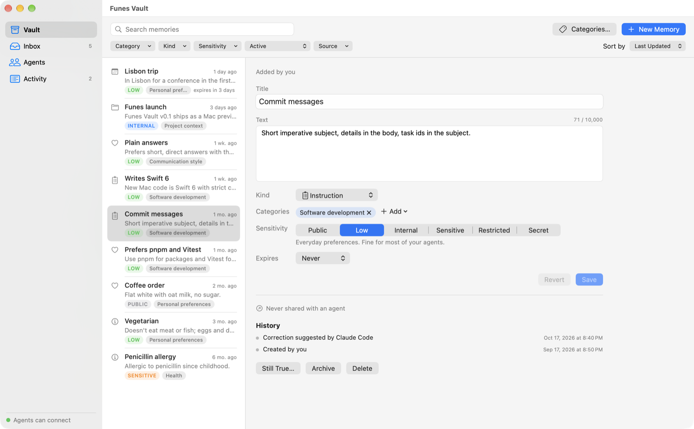
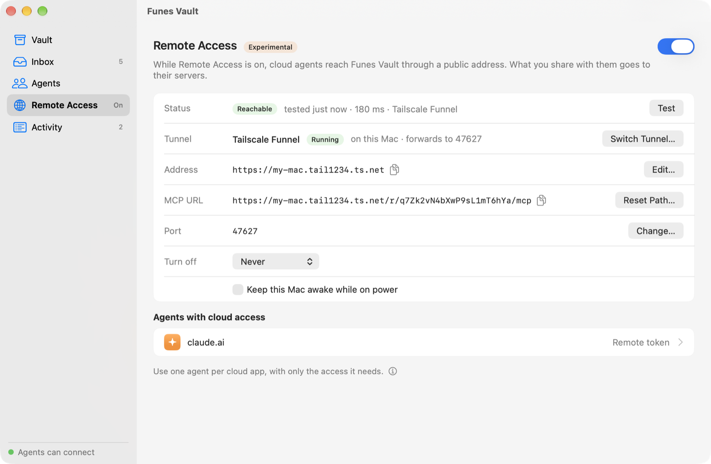
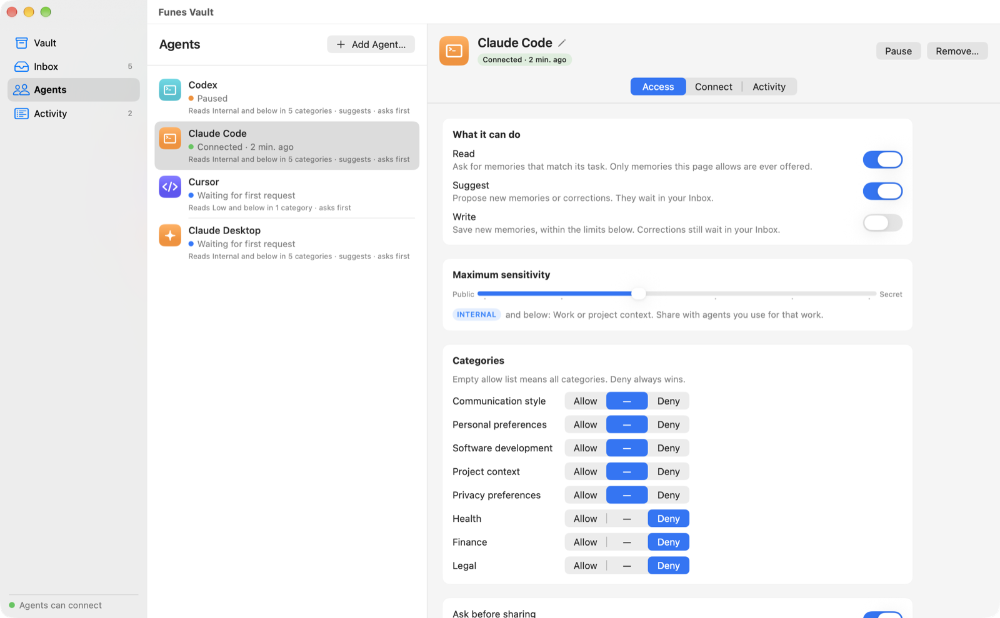
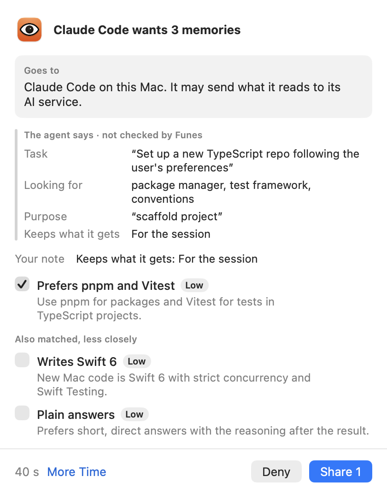
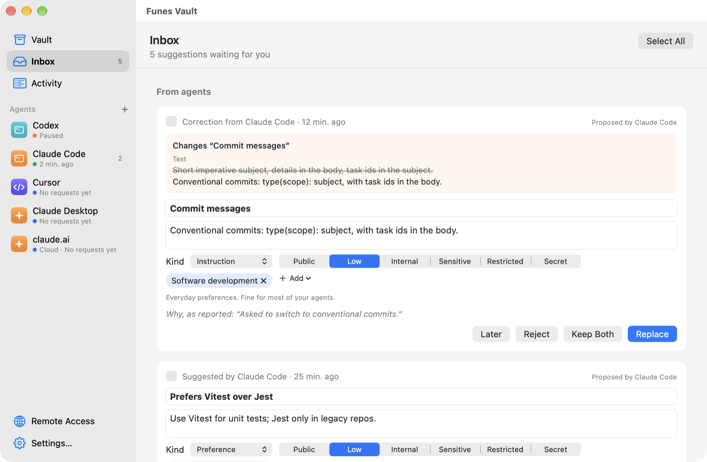
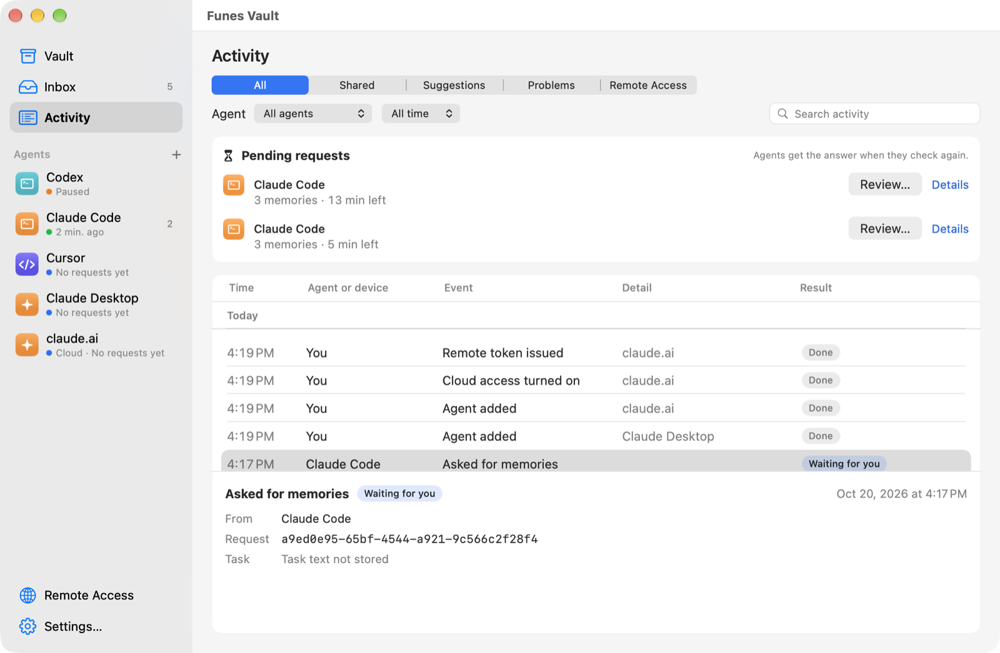

<h1 align="center">Funes Vault</h1>
<p align="center"><b>Give AI agents your memory. Not all of it.</b><br>
A free, open-source Mac menu bar app that keeps your personal context in a private vault on your Mac, and shares it with Claude, Cursor, Codex and other AI agents only as you allow.</p>

<!--
Badges, once the listings exist:
<p align="center">
  <a href="https://github.com/bereciartua/funes-vault-app/releases/latest"></a>
  
  <a href="LICENSE"></a>
  MCP Registry (com.funesvault/funes), mcpservers.org and glama.ai badges go here.
</p>
-->

<p align="center">
  <a href="https://github.com/bereciartua/funes-vault-app/releases/latest/download/FunesVault.dmg"><b>Download for Mac</b></a> ·
  <a href="#get-started">Get started</a> ·
  <a href="docs/MCP.md">Agent setups</a> ·
  <a href="CHANGELOG.md">Changelog</a>
</p>

<p align="center">
<picture>
  <source media="(prefers-color-scheme: dark)" srcset="docs/images/vault-memory-dark.png">
  
</picture>
</p>

- **Each agent gets only what you choose.** Its own key, and the access you set: read, suggest or save; up to a sensitivity level; in the categories you pick. A new agent can start with nothing.
- **You approve the exact text.** Before a memory goes to an agent, a small panel shows it, and you can untick what shouldn't go. An approval is used once, within 15 minutes, and is cancelled if anything changes.
- **Agents suggest; you decide.** What an agent wants to remember waits in your Inbox, where you edit it, apply it or reject it.
- **Everything stays on your Mac.** No account, no server of ours, no cloud copy. Search runs on a small model built into the app. Cloud agents such as claude.ai and ChatGPT can reach it only through a tunnel you run, with Remote Access (experimental, off by default).

**Status:** public preview (v0.1), with best-effort support. **Works with** Claude Code, Claude Desktop, Cursor and Codex, with ready-made setups for VS Code (Copilot), Gemini CLI, Zed, Cline, JetBrains AI Assistant, Devin Desktop and any other MCP client. **From the cloud (experimental):** claude.ai, ChatGPT, Gemini Enterprise, the Anthropic and OpenAI APIs, and cloud coding agents, through Remote Access.

## Get started

1. **Install.** Download [`FunesVault.dmg`](https://github.com/bereciartua/funes-vault-app/releases/latest/download/FunesVault.dmg), open it and drag Funes Vault to **Applications**. If you open it from the disk image or Downloads instead, it offers to move itself there. Or use [Homebrew](https://brew.sh):

   ```sh
   brew install --cask bereciartua/tap/funes-vault
   ```

   Funes Vault needs **macOS 15 or later**, on Apple silicon or Intel.

2. **Open the app.** It lives in the menu bar. The Vault opens with a short setup checklist:
   1. **Connect an agent.** **Add…** opens Add Agent, with the agents found on your Mac first. Pick one and a starting access: the default, **Read low-sensitivity memories, ask first**, lets it read memories up to Low and asks you before each share. For Claude Code, Claude Desktop, Cursor and Codex, **Add and Connect…** shows exactly what it will change or run first, backs up a settings file before changing it, and never writes the key into the agent's settings. For other agents, copy the setup from the agent's **Connect** tab.
   2. **Approve its first request.** Ask your agent something, for example *"Plan a week of dinners for me"* or *"Set up this TypeScript project the way I like it."* The agent asks Funes for context, you see the panel, and you choose what to share. The step is done when the agent's first request arrives.
   3. **Seed your vault.** Answer a few optional questions, import your ChatGPT memories or paste Claude's, or import a Markdown file. What you add goes to the Inbox first, and anything that looks like a secret is never imported. The questions end with the categories agents should never see: those get Deny for every agent, including ones you add later.
   4. **Review your Inbox.** Apply what's right; edit or reject the rest.

You can also capture a thought at any time with **⌥⌘M**, **Remember…** in the menu, or **Services ▸ Remember in Funes** in any app.

Setups for every agent, the tool reference and troubleshooting are in the [MCP guide](docs/MCP.md).

### From cloud agents (experimental)

claude.ai, ChatGPT and cloud coding agents run on their vendor's servers, so they can't reach an app on your Mac directly. **Remote Access** lets them, through a tunnel you run, such as [Tailscale Funnel](https://tailscale.com/kb/1223/funnel):

1. Open **Remote Access** in the sidebar and follow its four steps: choose a tunnel, turn Remote Access on and start the tunnel, paste its address, test. Funes never starts a tunnel; it shows the command.
2. Add the agent on the **Cloud · Experimental** tab of **Add Agent…** (claude.ai, ChatGPT, …), or turn on **Allow cloud access** on an agent's **Cloud** tab.
3. Connect it: apps that sign in (claude.ai, ChatGPT, Gemini Enterprise) use **Connect a Cloud App…** and a six-digit code you compare on the Mac; the others use the agent's remote token. The agent's **Cloud** tab shows the steps for each.

<picture>
  <source media="(prefers-color-scheme: dark)" srcset="docs/images/remote-access-dark.png">
  
</picture>

A cloud agent gets exactly the access you set for it, and the same panels on your Mac: if you're away, its requests wait and expire as for any agent. While Remote Access is on, the vault is reachable through a public address, and what you share with a cloud agent goes to its vendor's servers. It's off by default, and **Turn Off Remote Access** in the menu bar cuts every cloud agent off at once. The [MCP guide](docs/MCP.md#use-from-cloud-agents) has the details.

## How you stay in control

Funes is the only thing that holds your memories. Agents talk to it, never to the vault directly, and it checks every request against what you allowed.

### You choose what each agent may see

Every agent has its own access: whether it may **Read**, **Suggest** or **Write**; a **maximum sensitivity** (Public, Low, Internal, Sensitive, Restricted or Secret); the categories it may or may not use (a denied category always wins); whether Funes **asks before sharing** and **asks before saving**; and an optional expiry date. Health, Finance and Legal memories are Sensitive by default.

<picture>
  <source media="(prefers-color-scheme: dark)" srcset="docs/images/agents-access-dark.png">
  
</picture>

### You approve the exact text

When an agent asks for context, Funes finds the memories that match its task and are allowed for that agent. If asking is on, a panel shows each one with a checkbox, what the agent says it's for, how long it keeps what it gets, and how many more matched but can't go to it. **Share** sends only what you ticked; **Deny** sends nothing. The agent waits up to 45 seconds. If you don't answer in time, the request waits in **Pending requests** for up to 15 minutes, and the agent picks up your answer later; **More Time** moves it there at once. **Review Request (⌃⌥⌘R)** brings a waiting panel forward from any app.

<picture>
  <source media="(prefers-color-scheme: dark)" srcset="docs/images/share-panel-dark.png">
  
</picture>

Nothing an agent writes in its task or purpose changes what it may see. Those words only help find relevant memories.

### Agents suggest, you decide

Agents propose memories, and by default each one waits in the **Inbox** as a card you can edit before **Apply** (**Replace** or **Keep Both** for a correction), **Reject** or **Later**. Cards say who proposed what, quote the agent's reasons as reported, point out similar memories, and show a correction as old and new text. Your own captures and imports land there too. With **Split into separate memories** on (Settings ▸ AI Models, with a local server or cloud model), what arrives is split into one suggestion per claim, each marked New, Updates *a memory*, Already saved or Removes *a memory*, on one card with **Apply All** and **Keep as One**.

<picture>
  <source media="(prefers-color-scheme: dark)" srcset="docs/images/inbox-dark.png">
  
</picture>

### You see everything, and stop anything

**Activity** lists what each agent asked for and what happened, by day, with filters. Funes stores only ids and reason codes, never text: it shows the memories involved by their current title when you open a row, says what was withheld and why, and links to fix a refusal. **Pause** an agent to refuse its requests while keeping its setup, **Remove…** it to cut it off, or **Pause Funes Vault** from the menu bar for an hour, until tomorrow or until you resume.

<picture>
  <source media="(prefers-color-scheme: dark)" srcset="docs/images/activity-dark.png">
  
</picture>

### Under the hood

- **Local by default.** The MCP server listens on `127.0.0.1:47625`, never on a network interface. No account, no analytics, no server of ours. Remote Access, off by default, opens a second loopback port only a tunnel you run can expose.
- **A key per agent.** Each agent has its own 256-bit key in a private file; the vault stores only its hash. One-click setups and the launcher read the file instead of putting the key in the agent's config.
- **Fail closed.** Any doubt about an agent or a request is a refusal. Refusals tell the agent *how many* memories were withheld and why, never which ones.
- **Single use.** An approved share is delivered once, within 15 minutes, and only if the memories and the agent's access are unchanged.
- **Secrets stay out.** A secret scanner checks captures, suggestions and imports, and everything sent to a model you chose.
- **Signed updates.** Updates come from GitHub, signed for Funes Vault and checked before they install. Installing always takes a click.
- **Open source.** Read the code, the [architecture](docs/ARCHITECTURE.md) and the [test record](docs/TESTING.md).

**What it doesn't protect against:** another program running as your macOS user can read the same vault and key files. Access settings separate the agents you connect; they aren't a defense against malware already on your Mac. Details are in [Security boundary](#security-boundary).

## What agents can do

Agents see four main tools, and only the ones their access allows:

| Tool | What it does | Needs |
| --- | --- | --- |
| `list_memory_categories` | Lists your categories and what this agent may do in each. No memories, no counts. | Always available |
| `request_memory` | Asks for memories relevant to a task, with keywords for the kinds of context that would help. Returns them, asks you first, or refuses with a reason. | Read |
| `get_memory_request` | Picks up a request you answered after the agent stopped waiting. Delivered once. | Read |
| `suggest_memory` | Proposes a memory or a correction. It goes to your Inbox, or straight into the vault if you let that agent save without asking. | Suggest or Write |

A fifth, `open_in_funes`, only brings Funes to the front at one of the agent's own pending requests or suggestions. The [MCP guide](docs/MCP.md#tools) has every argument and outcome.

## FAQ

<details>
<summary><b>Is it free?</b></summary>

Yes. Funes Vault is open source under the Apache License 2.0, with no account or trial.
</details>

<details>
<summary><b>Do my memories leave my Mac?</b></summary>

Only what you share with an agent, which then goes to that agent and its AI provider under their terms. Funes itself has no server. Search, and the proposals for new captures, run on your Mac by default. If you choose a cloud model for those proposals, Funes says what it sends, and never sends anything above your cloud limit (Internal by default). [Privacy](#privacy) lists every connection the app makes.
</details>

<details>
<summary><b>Does it always ask before sharing?</b></summary>

By default, yes: every starting access asks before each share. You can turn **Ask before sharing** off for an agent you trust; it then gets the memories it's allowed to read without a panel, and each share still shows in Activity.
</details>

<details>
<summary><b>What if I'm not at my Mac when an agent asks?</b></summary>

The agent waits 45 seconds, then is told the request is waiting for your approval. The request stays in **Pending requests** in the menu bar menu for 15 minutes. If you share it in that time, the agent gets the memories the next time it checks.
</details>

<details>
<summary><b>Does it work with claude.ai or ChatGPT?</b></summary>

Yes, through Remote Access (experimental): a tunnel you run, such as Tailscale Funnel, makes Funes reachable at a public address, and claude.ai or ChatGPT signs in after you open pairing and compare a code on your Mac. Each cloud app uses one agent's access, with the same panels as any agent. See [From cloud agents](#from-cloud-agents-experimental).
</details>

<details>
<summary><b>Can an agent change or delete my memories?</b></summary>

No. Agents can only propose new memories and corrections. An agent you give **Write** with **Ask before saving** off can save new memories directly, within its categories and sensitivity limit; its corrections still wait in your Inbox.
</details>

<details>
<summary><b>Does it need Apple Intelligence?</b></summary>

No. Search uses a small model built into the app (bge-small, on your Mac). Apple's on-device model, when your Mac has it (macOS 26 or later with Apple Intelligence), proposes titles, categories and sensitivity for captures; otherwise simple rules do. You can also choose Ollama, LM Studio, Anthropic, OpenAI or another OpenAI-compatible server for that in **Settings ▸ AI Models**, or your Claude or ChatGPT plan through the Claude Code or Codex you already use (no API key), and with one of those, turn on **Split into separate memories**, which splits captures, agents' suggestions and imports into single memories and links them to what your vault holds. Every piece waits for you in the Inbox.
</details>

<details>
<summary><b>Is there an iPhone app?</b></summary>

Not yet. An iPhone companion that captures thoughts, searches the vault when your Mac is reachable and lets you approve agents' requests is planned for v0.2.
</details>

<details>
<summary><b>Is it made by Apple, Anthropic or OpenAI?</b></summary>

No. Funes Vault is an independent open-source project, not affiliated with or endorsed by any of them.
</details>

Something else? Open an [issue](https://github.com/bereciartua/funes-vault-app/issues).

## Security boundary

- **MCP server.** Runs while **Settings ▸ MCP ▸ Let agents connect** is on (the default), and listens only on `127.0.0.1` (port 47625 unless you change it in the same pane). Every request needs an agent's own key; the vault stores only its SHA-256 hash. Requests with a foreign `Host`, any `Origin` (web pages) or tunnel forwarding headers are refused, and repeated failed sign-ins are locked out for a minute. Paused and expired agents are refused; removed agents' keys no longer work.
- **Agent keys.** Each key is a file only you can read (mode 0600, in a 0700 folder) under `~/Library/Application Support/FunesVault/agent-keys/`. The `funes-mcp` launcher sends it only after checking that the program on the port is your own Funes Vault. **Rotate Key…** replaces it at once.
- **Access decisions.** Made inside Funes from the agent's access, each memory's sensitivity and categories, and your answer, never from what the agent writes. An approval is bound to the exact memories and versions you saw.
- **Data at rest.** The vault is an SQLite file in your Application Support folder, protected by FileVault, not by its own encryption. Backups stay in the same folder.
- **Models.** Text goes to a model provider only if you added one and chose it, never above your cloud limit for a cloud provider, and never when it looks like a secret.
- **Remote Access (experimental, off by default).** While it's on, a second listener on `127.0.0.1` (port 47627 unless you change it on the Remote Access page) answers what a tunnel you run forwards from the internet. Every route sits under a 128-bit secret path (anything else is 404), `Host` must be your tunnel's address (or the loopback address, for tunnels that rewrite it), and every call needs a credential of an agent you allowed cloud access: its remote token, or an OAuth token from a cloud app you approved with a six-digit code while pairing was open for that agent. Local keys don't work remotely and remote credentials don't work locally. Repeated failed sign-ins from one address are locked out for 5 minutes, and remote calls have a stricter rate limit. The same access, panels and pending list apply as for agents on your Mac. Text you share with a cloud agent goes to its vendor; some tunnels (Cloudflare, ngrok) can read the traffic, while Tailscale Funnel ends TLS on your Mac.

**These controls do not isolate another process running as the same macOS user.** Such a process can read the vault, the backups and the key files. Funes also can't recall or control text after you've shared it with an agent. An access setting is a boundary between the agents you connect, not a defense against a compromised user account. See the [threat model](docs/ARCHITECTURE.md#threat-model).

Report vulnerabilities privately, as described in [SECURITY.md](SECURITY.md).

## Privacy

The app has **no analytics, telemetry or crash reporting**, and no account. Your memories, agents, keys and Activity stay on your Mac. These are the connections it makes:

| Connection | When |
| --- | --- |
| MCP server, listening on `127.0.0.1:47625` | While **Let agents connect** is on. Loopback only: other computers can't connect. |
| `funes-mcp` connecting to `127.0.0.1` | When an agent on your Mac starts it, to reach the MCP server. |
| One HTTPS request to GitHub for `appcast.xml` | Once a day while **Settings ▸ Updates ▸ Check for updates every day** is on, and when you choose **Check for Updates…**. GitHub sees your IP address and the app's version. A copy built from source never checks. |
| Downloading an update from GitHub | Only after you click to install it. |
| Remote Access listener, on `127.0.0.1` (port 47627 by default) | Only while **Remote Access** is on (off by default). Loopback only; a tunnel you run, such as Tailscale Funnel, makes it reachable from the internet at an address you choose. Funes never starts a tunnel. |
| One HTTPS request to your tunnel's address | When you click **Test** on the Remote Access page (and during its setup): Funes fetches its own health URL through the tunnel. |
| One HTTPS request to a cloud app's metadata document | Only while you have pairing open, when that app starts signing in (claude.ai and ChatGPT publish one). No credential is sent. |
| The model provider you added | Only if you add one in **Settings ▸ AI Models** and choose it: to propose a title, categories and sensitivity for each capture, and for **Load Models** and **Test Connection** (which send none of your data). A local server (Ollama, LM Studio) stays on your Mac or local network; a cloud provider gets only captures at or below your cloud limit that passed the secret scanner, plus your category names and descriptions. With **Split into separate memories** on, it also gets agents' suggestions, your answers and imported items, and each piece with up to 5 related memories, under the same limit and scanner ([PRIVACY.md](PRIVACY.md#ai-models)). |

Notifications, shown by macOS, never include memory text. What an agent receives through Funes goes to that agent and its AI provider, under their privacy terms, so give each agent only what it needs. With Remote Access, that includes the cloud agents you allow, and the tunnel provider if its TLS ends at its edge. The full statement is in [PRIVACY.md](PRIVACY.md) and at [funesvault.com/privacy](https://funesvault.com/privacy).

## Docs

| Goal | Guide |
| --- | --- |
| Connect an agent; the tools, limits and troubleshooting | [MCP guide](docs/MCP.md) |
| How it's built, where data lives, the threat model | [Architecture](docs/ARCHITECTURE.md) |
| What was tested, and how | [Testing](docs/TESTING.md) |
| Everything that leaves the Mac | [Privacy](PRIVACY.md) |
| Report a vulnerability | [Security](SECURITY.md) |
| Contribute, or maintain and release | [Contributing](CONTRIBUTING.md), [Maintaining](docs/MAINTAINING.md) |
| The full product definition: requirements, access policy, decisions | [spec/](spec/README.md) |

## Building from source

You need Xcode 27 (which runs on macOS 26.6 or later) and Python 3.11 (to convert the embedding model once). The app you build runs on macOS 15 or later.

```sh
sh scripts/fetch_embedding_model.sh
sh scripts/test.sh
```

The first command downloads the bundled embedding model ([bge-small-en-v1.5](https://huggingface.co/BAAI/bge-small-en-v1.5)) at a pinned revision, checks its checksums and converts it to Core ML in `~/Library/Caches/com.funesvault.dev/`; it isn't in git. The second runs the package tests, the MCP harness and the other checks, and builds the app unsigned. To work on the app, open `FunesVault.xcodeproj` in Xcode and run the **FunesMac** scheme. Debug builds honour `FUNES_DATA_DIR`, so a development vault never touches your real one. See [Contributing](CONTRIBUTING.md).

## Uninstall

1. If you used Remote Access, turn your tunnel off: the Remote Access page shows how.
2. Quit Funes Vault from its menu.
3. Remove Funes from your agents' configs (for example `claude mcp remove --scope user funes`).
4. Delete the app from Applications, and its data: `~/Library/Application Support/FunesVault` (the vault, backups, agent keys and Activity). Its settings are in `~/Library/Preferences/com.funesvault.mac.plist`. If you linked the launcher, delete `~/.local/bin/funes-mcp`. API keys for model providers you added are in the Keychain under `com.funesvault.provider`.

To start over without uninstalling, **Settings ▸ Data ▸ Erase All Data…** deletes every memory, suggestion, agent and key, Activity, backups, provider keys and settings, then relaunches empty.

Installed with Homebrew, `brew uninstall --cask funes-vault` removes the app; `brew uninstall --zap --cask funes-vault` also moves the data folder, caches and preferences to the Trash (provider API keys stay in the Keychain).

## License

Funes Vault is licensed under the [Apache License 2.0](LICENSE); see [NOTICE](NOTICE). The app bundles BridgeKit (Apache License 2.0, by the same author), and GRDB.swift, Sparkle and the bge-small-en-v1.5 model by BAAI, each under the MIT License; their licence texts ship in the app. The license doesn't grant rights to the project's name or icon. Apple, Mac and macOS are trademarks of Apple Inc. This project is not affiliated with or endorsed by Apple, Anthropic, OpenAI or BAAI.

Funes Vault is made by [Martin Bereciartua](https://www.linkedin.com/in/bereciartua/), who also makes [EK Bridge](https://github.com/bereciartua/ek-bridge).
