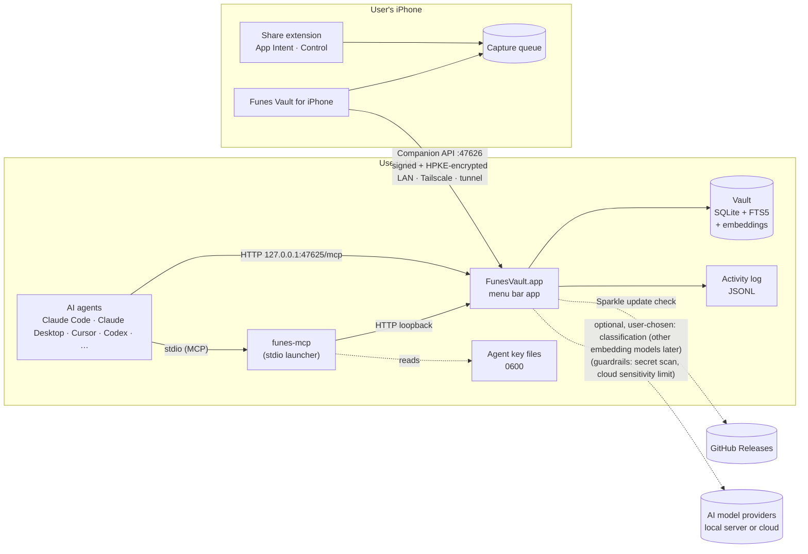
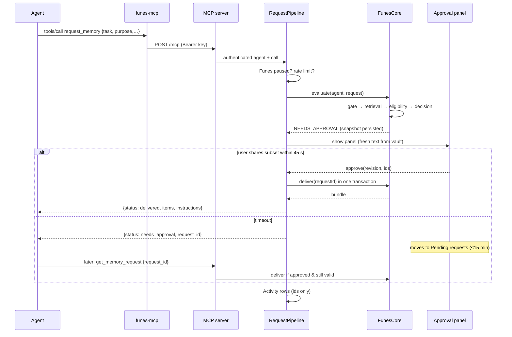
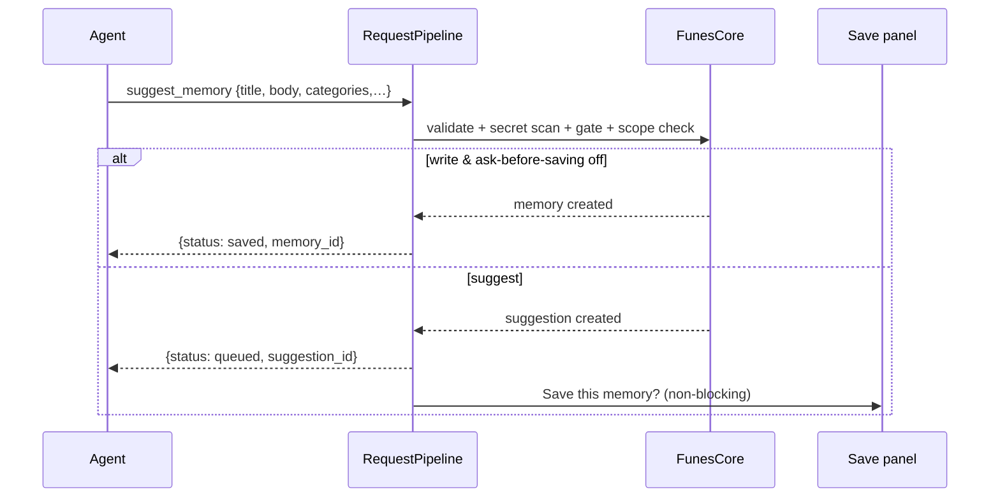
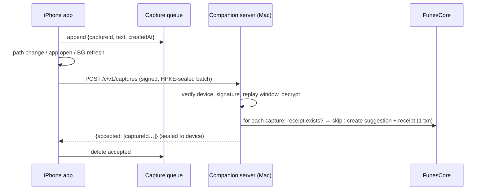

# Architecture overview

## System context



**Trust boundaries:**
- **Agents** are untrusted parties with scoped access. Their keys separate them from each other.
- **The iPhone** is trusted as the owner once paired, but every message is authenticated and encrypted.
- **AI model providers** the user chose (local servers or cloud) receive only what the guardrails allow ([model providers §5](model-providers.md#5-guardrails-all-non-local-providers)). By default there are none: Apple's on-device models.
- **Everything else** on the network is untrusted.
- **Other software running as the user** is out of scope (see [security](security-and-privacy.md)).

## Components

### FunesVault.app (macOS, one process)
| Layer | Contents | Origin |
|---|---|---|
| **UI** (SwiftUI in AppKit) | Menu bar controller, main window (Vault, Inbox, Agents, Activity, iPhone, Settings), capture box, panels | New, with EK Bridge shells |
| **App services** | `RequestPipeline` (gate → rate limit → handler → approvals → activity), `ApprovalCenter`, `AccessRequests`, `ActivityStore`, `AgentSetup`/`AgentConfigWriter`, `Updater` (Sparkle), `AppMover`, `LoginItem`, `HotKey`, `ServicesProvider`, `Notifications` | **BridgeUI** (copied from EK Bridge) on top of **BridgeKitCore** |
| **MCP adapter** | `LoopbackHTTPServer`, `MCPServer` (JSON-RPC, protocol versions) from **BridgeKitCore**; the tool contract, `RequestPipeline` and handlers in **FunesMCP** ([ADR-0017](decisions/0017-funes-mcp-package.md)) | **BridgeKitCore** (shared library) + **FunesMCP** (package) |
| **Companion adapter** (v0.2) | `CompanionServer` (HTTP listener on 47626), `PairingService`, `DeviceRegistry`, `EnvelopeCrypto` (HPKE + P-256 signatures), `BonjourAdvertiser` | New, with BridgeKitCore HTTP parts |
| **FunesCore** (package) | `VaultStore` (GRDB), `PolicyEngine`, `Retrieval`, `BundleCompiler`, `DisclosureService`, `SuggestionService`, `CaptureService`, `ImportExport`, `Embeddings` (bundled bge-small Core ML, WordPiece tokenizer, vector index), `Classifier`, `Provenance`, **`Models`** (`ModelRouter`, Apple, OpenAI-compatible and Anthropic providers; see [model providers](model-providers.md)) | New, porting the web version's rules |
| **FunesProtocol** (package, shared with iOS) | Companion request and response types, envelope format, `SecretScanner`, input limits, enums | New |

### funes-mcp (launcher, inside `FunesVault.app/Contents/MacOS/`)
- Relays stdio JSON-RPC lines to `POST http://127.0.0.1:<port>/mcp`.
- Reads the agent's key from `~/Library/Application Support/FunesVault/agent-keys/<agentId>.key`.
- Before sending the key, it verifies that the listener in `mcp-endpoint.json`:
  - belongs to the same user;
  - comes from a process with Funes's bundle ID;
  - holds the socket.

  This uses `libproc`, as in EK Bridge's `MCPLauncher`.
- Has `headers` and `check` subcommands (Claude Code's `headersHelper` and a self-test).

### Funes Vault for iPhone
| Part | Contents |
|---|---|
| **App** (SwiftUI) | Capture, Search, Inbox, Settings, Pairing (VisionKit scanner), Demo vault |
| **CompanionClient** | Discovery (Bonjour `NWBrowser`, saved Tailscale address and tunnel URL), envelope crypto, request retries, `NWPathMonitor` |
| **CaptureQueue** | SQLite or file store in the App Group container, shared with the extensions |
| **Share extension, App Intent, Control** | Append to `CaptureQueue` only. No networking in extensions |
| **FunesProtocol** | Shared package |

## Concurrency model (Mac)
- **Main actor:** UI, `ApprovalCenter`, panels and `RequestPipeline` decisions that touch approvals. This mirrors EK Bridge, where requests hop from the listener queue to the main actor.
- **Network queues:** each listener (`mcp.http`, `companion.http`) parses on its own queue, then hops to the main actor for the pipeline. Bodies are limited to 64 KiB for MCP and 256 KiB for the companion API.
- **`VaultStore`:** a GRDB `DatabasePool` (WAL), so reads run concurrently and writes are serialized. Disclosure, suggestion-apply and import flows each run in one `write { }` transaction.
- **Background work** (Swift concurrency `Task` with low priority): embedding updates, classification, activity compaction, purging deleted memories, backups and suggestion expiry. Each is idempotent and cancellable.
- **Timeouts:**
  - MCP call: 55 s overall;
  - approval panel: 45 s;
  - pending approvals: 15 min;
  - the iPhone uses a 10 s request timeout.

## Key flows

### Request with approval


### Suggestion


### iPhone capture delivery


## Lifecycle
- **Launch:**
  1. Open the database, running migrations with a backup first.
  2. Load agents and devices.
  3. Start the MCP listener if enabled, and write `mcp-endpoint.json`.
  4. Start the companion listener and Bonjour if iPhone access is on.
  5. Schedule background maintenance.
- **Sleep and wake:** listeners survive sleep. On wake, the app re-advertises Bonjour and expires pending approvals whose 15 minutes have passed.
- **Quit:** answer calls in progress (a call waiting for the user gets `denied`, `funes_quit`, and its request stays pending), withdraw open panels, then stop the listeners and remove `mcp-endpoint.json`.
- **Update:** Sparkle's relaunch waits while panels or pending approvals exist (EK Bridge's `UpdateRelaunchGate`).

## Repository layout (proposed)
```
funes-vault-app/
├── FunesVault.xcodeproj
├── Apps/
│   ├── FunesMac/            # app target (AppKit + SwiftUI), Info.plist, entitlements
│   ├── FunesMCPLauncher/    # funes-mcp command-line target
│   ├── FunesiOS/            # iPhone app target
│   ├── FunesShareExtension/
│   └── FunesIntents/        # App Intents / Control extension
├── Packages/                # each package keeps its own Tests/ (SwiftPM needs them inside the package)
│   ├── FunesCore/           # vault logic (Mac only); Tests/FunesCoreTests: policy vectors, store, search
│   ├── FunesProtocol/       # shared Mac + iOS; Tests/FunesProtocolTests
│   ├── FunesMCP/            # MCP contract, pipeline, handlers, FUNES_MCP_TEST server (ADR-0017)
│   └── BridgeUI/            # UI pieces copied from EK Bridge (→ BridgeKitUI after v0.1)
│   (BridgeKit/BridgeKitCore is an external package: github.com/bereciartua/bridgekit)
├── Resources/               # icons, seed data
├── Tests/                   # cross-cutting harnesses outside SwiftPM
│   ├── mcp/                 # Python loopback harness + golden fixtures
│   └── companion/           # protocol tests, fuzzing
├── scripts/                 # release.sh, make_dmg.sh, appcast.py, … (from EK Bridge)
├── docs/                    # ARCHITECTURE, MCP, COMPANION, TESTING, MAINTAINING, SECURITY
└── server.json              # MCP Registry
```
See [project setup](../plans/project-setup.md) for targets, bundle IDs and signing.
