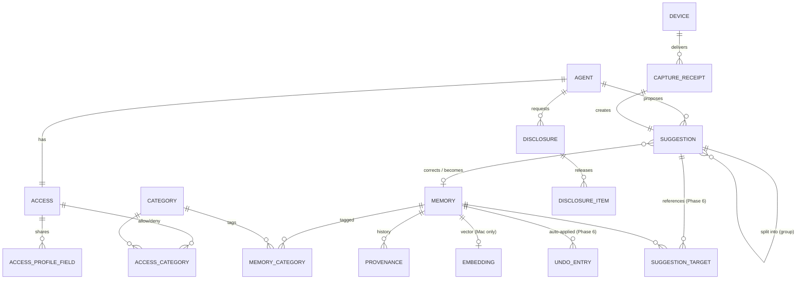
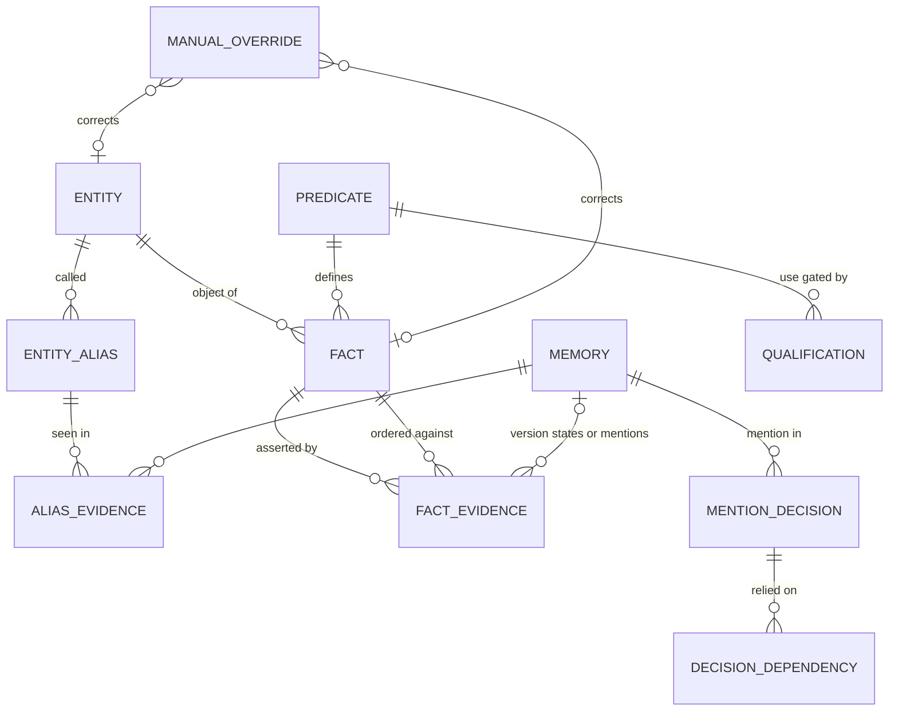
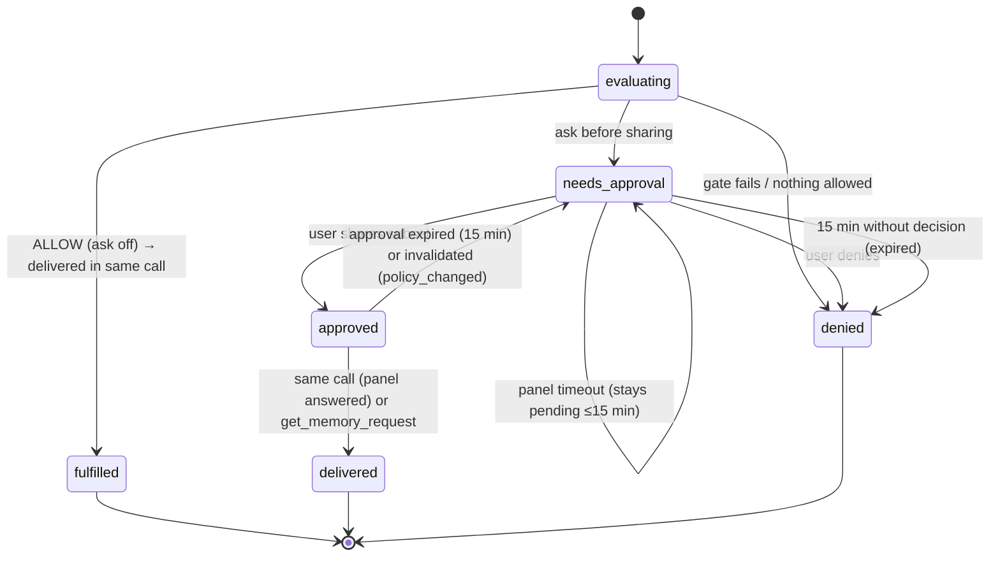
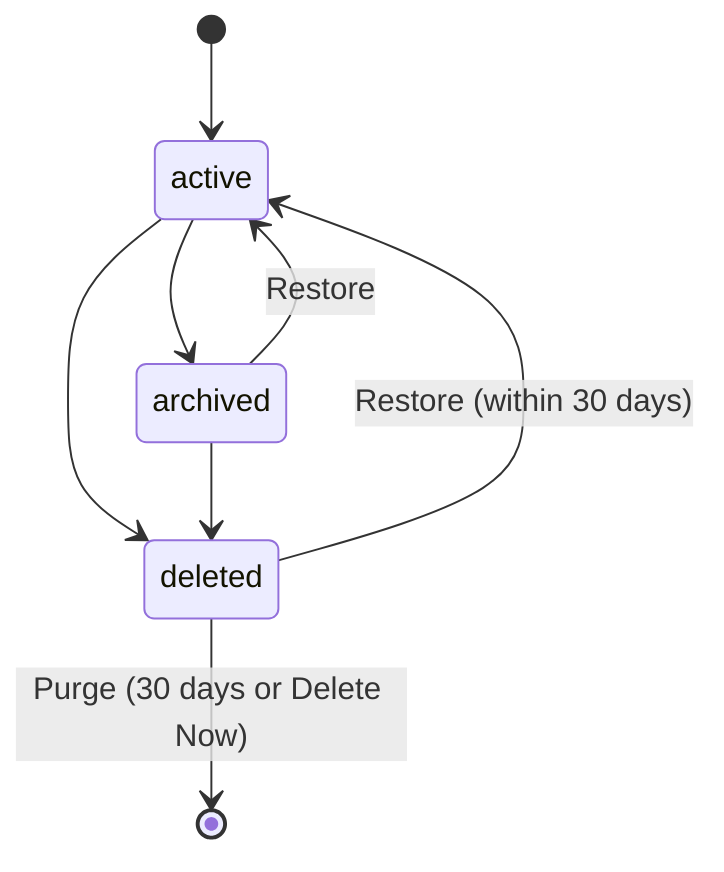

# Domain model

**This is a fresh design.** The Funes Vault web schema is used only as reference; [ADR-0010](../architecture/decisions/0010-start-from-scratch.md) explains why. The physical SQLite schema is in [storage](../architecture/storage.md).

## Entities

### Memory
A durable piece of personal context.

| Field | Type | Notes |
|---|---|---|
| `id` | UUID | Stable, never reused |
| `title` | string, 1–180 | Shown in panels, search and lists |
| `body` | string, 1–10,000 | The text released to agents is `title: body` |
| `kind` | MemoryKind | |
| `sensitivity` | Sensitivity | Default LOW; Health, Finance and Legal default to SENSITIVE |
| `status` | `active` · `archived` · `deleted` | Expiry is computed, not a status |
| `expiresAt` | date? | Treated as expired when `expiresAt <= now` |
| `confidence` | 0–1? | From suggestions; informational |
| `source` | MemorySource | `manual` · `capture_mac` · `capture_iphone` · `agent_suggestion` · `agent_write` · `import_chatgpt` · `import_claude` · `import_markdown` · `import_funes` · `seed_question` · `tidy_up` (Phase 6: a merge or split result) |
| `sourceAgentId` / `sourceDeviceId` | UUID? | Who it came from |
| `createdAt`, `updatedAt` | timestamps | |
| `lastConfirmedAt` | timestamp? | "Still true" |
| `deletedAt` | timestamp? | Set with status `deleted`; purged 30 days later |
| `version` | int | +1 on every change to the title, body, kind, categories, sensitivity, status or expiry. Used to invalidate disclosures |
| `trust` | `trusted` · `untrusted` | Phase 6. Where the text came from: `trusted` if the user typed or dictated it or applied it from a suggestion; `untrusted` if an agent saved it directly, or auto-apply saved it from an import or shared text. Auto-apply never changes or archives a memory on the strength of untrusted text ([memory processing §5.7](memory-processing.md#57-auto-apply-for-new-memories)). A user edit or Apply makes it trusted |
| `reconciledVersion` | int? | Phase 6. The `version` the daily tidy-up last inspected ([memory processing §9.2](memory-processing.md#92-what-it-looks-at)) |

**Invariants:**
- A memory has at least one category.
- Text passes the secret scanner.
- `deleted` memories are invisible everywhere except Recently Deleted.

### Category
| Field | Type | Notes |
|---|---|---|
| `key` | slug, unique, immutable | e.g. `software_development` |
| `name` | string | Can be renamed |
| `description` | string | |
| `builtin` | bool | Built-in categories can't be deleted |
| `defaultSensitivity` | Sensitivity | LOW, or SENSITIVE for `health`, `finance` and `legal` |
| `sortOrder` | int | |

**Built-in categories** (keys from the web version):
- `communication_style`
- `personal_preferences`
- `software_development`
- `project_context`
- `privacy_preferences`
- `health`
- `finance`
- `legal`

### Suggestion
A proposed memory waiting for review. It is separate from Memory, so memories never have a "pending" state.

| Field | Type | Notes |
|---|---|---|
| `id` | UUID | |
| `origin` | `agent` · `capture_mac` · `capture_iphone` · `import` · `seed_question` · `consolidation` (the daily tidy-up, Phase 6) | |
| `agentId` / `deviceId` / `importRunId` | UUID? | |
| `captureId` | UUID? | Idempotency key for iPhone captures (unique) |
| `targetMemoryId` | UUID? | Set when the suggestion is a correction of an existing memory |
| `targetMemoryVersion` | int? | Phase 6. The target's version when the suggestion was made; checked when it's applied (stale → the card says so) |
| `action` | `create` · `update` · `archive` · Phase 6: `duplicate` (already saved) · `split` · `merge` · `conflict` | Each action has its own apply ([memory processing §5.5](memory-processing.md#55-linking), [§9.5](memory-processing.md#95-inbox-and-auto-apply)), below |
| `groupId` | UUID? | Phase 6. The original suggestion a piece was split from (status `split`) |
| `intent` | `assertion` · `remember` · `correction` · `retraction`? | Phase 6, from extraction |
| `outsideScope` | bool | Phase 6. A piece of an agent's input outside that agent's scope: never auto-applied, left out of Apply all |
| `title`, `body`, `kind`, `categoryKeys`, `sensitivity`, `expiresAt`, `confidence` | proposed values | All editable before apply |
| `evidence` | string?, ≤ 2,000 | Quoted support from the agent; shown as data |
| `purpose` | string?, ≤ 160 | As reported by the agent |
| `callerMetadata` | JSON? | Inert. Never interpreted |
| `classification` | JSON? | Proposed fields plus the engine that produced them (`apple.foundation`, `rules`, or a provider and model id such as `anthropic/<model>`), and whether the capture was kept on the device by the pre-screen |
| `status` | `pending` · `applied` · `rejected` · `expired` · `split` (Phase 6: replaced by its pieces; the row stays for receipts and idempotency) | |
| `createdAt`, `decidedAt`, `expiresAt` | | Expires 30 days after creation; a group expires as one |
| `resultMemoryId` | UUID? | The memory created or updated when it was applied |

**Phase 6 additions** ([ADR-0020](../architecture/decisions/0020-atomic-extraction-for-every-source.md), [ADR-0021](../architecture/decisions/0021-daily-tidy-up.md)):
- **SuggestionTarget:** `suggestionId`, `memoryId`, `memoryVersion`, `role` (`target` · `source` · `survivor`), so a merge, split or conflict can reference several memories.
- **SuggestionGroup:** `id` (the original suggestion's id, or a Split this memory suggestion's), `origin`, `agentId?`, `sourceText`, `engine`, `createdAt`. The source text is dropped once every piece is decided (with the original row's title and body), and purged with its memories. A Split this memory suggestion's pieces show only on its card while it's `pending`.
- **ProcessingJob:** `id`, `subject` (suggestion or memory id), `kind` (`new_memory`: classification today, splitting from 6a · `tidy_up`), `state` (`queued` · `running` · `done` · `failed`), `attempts`, `engine`, `error` (why it failed or waits: `timeout`, `cap_reached`…; `cancelled` and `kept_as_one` on a `done` job the user ended), `notBefore`, `createdAt`. Durable, one at a time, idempotent per subject and kind. A `new_memory` split that fails is `failed` at once; Try again sets it `queued` again with no attempts.
- **A pending suggestion's processing** (memory processing §5.2), derived from its `new_memory` job, never stored on the suggestion: **processing** (the job is queued or running, splitting is on, and it's a new input: no group, no target, not the tidy-up's) can't be applied or edited, only rejected, which cancels the job; **failed** (the job failed) offers Try again and Keep as one; otherwise it's an ordinary pending suggestion.
- **UndoEntry:** `id`, `createdAt`, `runId?`, `suggestionId?`, `action`, memory ids, each memory's state before and (from v0.5) after the change (JSON, including the text), `expiresAt` (30 days). Activity's detail pane, a memory's History and the Applied automatically list show both. Purged after 30 days and with its memories when they're purged or deleted now. Never exported.
- **MemoryRevision** (v0.5, [ADR-0027](../architecture/decisions/0027-memory-revisions.md)): `memoryId`, `version` (the version it was), the state a change replaced (title, body, kind, categories, sensitivity, status, expiry), `replacedAt`, `replacedBy` (the change's actor). Kept 90 days and at most 50 per memory, purged with the memory. Never exported, shared or sent to the iPhone.
- **TidyUpRun:** `id`, `startedAt`, `finishedAt`, `engine`, counts (memories inspected, clusters, suggestions, applied), `partial`, error code, `scope` (`all`, or `memory` for Tidy Up on one memory).
- **TidyUpDismissal:** sorted memory ids plus a content hash, `dismissedAt`.

### Agent
An MCP client the user has added. It is EK Bridge's "connection".

| Field | Type | Notes |
|---|---|---|
| `id` | UUID | |
| `name` | string, unique among active agents | |
| `agentKind` | detected type (`claude_code`, `claude_desktop`, `cursor`, `codex`, `vscode`, `zed`, `gemini_cli`, `devin_desktop`, `cline`, `jetbrains`, `other`; the agents EK Bridge's setup knows; cloud agents add kinds such as `claude_ai`, `chatgpt`, `gemini_enterprise`, `anthropic_api`) | Drives the icon and setup snippets |
| `keyDigest` | SHA-256 | The key's plaintext lives only in the key file |
| `keyIssuedAt` | timestamp | |
| `cloudAccess` | bool | Default false. Lets the agent's remote token and OAuth-connected cloud apps reach it through Remote Access ([ADR-0018](../architecture/decisions/0018-remote-access-in-v0.1.md)). It never changes the agent's access |
| `remoteKeyDigest`, `remoteKeyIssuedAt` | SHA-256?, timestamp? | The remote token (`fns_mcpr_v1_`), only with `cloudAccess`. Deleted when cloud access is turned off |
| `paused` | bool | |
| `revision` | int | +1 on any change to access, key, cloud access, remote token or connected cloud apps. Pending approvals bind to it. Pause and resume don't change it: the gate refuses a paused agent, and an approval stands until it expires (access policy §3.7) |
| `declaredRetention` | `none` · `session` · `persistent` · `unknown` | Informational |
| `asksForAccess` | bool | Default false |
| `firstRequestAt`, `lastRequestAt` | timestamp? | |
| `createdAt`, `removedAt` | | Removal deletes the key file and grants; the row stays for Activity labels |

### Access (one per agent)
| Field | Type | Default |
|---|---|---|
| `operations` | set of `read`, `suggest`, `write` | empty (no access) |
| `maxSensitivity` | Sensitivity | LOW |
| `allowedCategoryKeys` | set | empty, meaning **all** categories |
| `deniedCategoryKeys` | set | empty |
| `askBeforeSharing` | bool | true |
| `askBeforeSaving` | bool | true (relevant only with `write`) |
| `expiresAt` | timestamp? | none |

| `profileFields` | set of ProfileField | `{name}` ([ADR-0026](../architecture/decisions/0026-about-you-profile.md)). Which parts of the profile go with this agent's `request_memory` answers ([access policy §3.10](access-policy.md#310-the-profile)) |

**Allow window** (optional, FR-D-12): `{agentId, revision, until, maxSensitivity ≤ LOW}`, held in memory only.

### Profile
What the user tells Funes about themself, shown in the app as **About you** ([ADR-0026](../architecture/decisions/0026-about-you-profile.md)). One per vault; every field is optional and starts empty. It isn't a memory: no categories, sensitivity, kind or provenance, never in a disclosure's snapshot, and memory processing (splitting, classification, the tidy-up) never reads or changes it.

**Its names identify you in memories** (v0.10, [ADR-0032](../architecture/decisions/0032-facts-about-you.md) decision 8). The Facts task matches the given, family and preferred names locally, so "Martin prefers…" is about *you* ([memory processing §11.9](memory-processing.md#119-privacy-and-trust)). The same names become "the user" in any memory text sent to a model (a Facts call or a search answer's input), with a map of offsets back for quotes. This use is for the owner only:
- the names are replaced before any memory is sent, never added to a call, never in a roster, and never stored on an entity (*you* has no stored name);
- another person sharing the name keeps it, in the same memory too;
- agent retrieval and `request_memory` answers are unchanged ([access policy §3.10–3.11](access-policy.md#311-learned-facts-and-the-profile-v010)).

| Field | Type | Notes |
|---|---|---|
| `givenName`, `familyName` | string? ≤ 80 each | Kept as `PersonNameComponents`, so the app shows them in the locale's order |
| `preferredName` | string? ≤ 80 | "What should Funes call you?". Empty means the given name. The greeting and agents use the **called name**: `preferredName`, else `givenName`, else none |
| `pronouns` | string? ≤ 40 | Free text, e.g. "she/her" |
| `languages` | [BCP 47 tag] ≤ 8 | Ordered: the first is the one the user writes in most |
| `location` | string? ≤ 120 | Free text, e.g. "Lisbon, Portugal" |
| `timeZone` | IANA id or `automatic` | Default `automatic`: the Mac's current time zone, read when it's needed |
| `occupation` | string? ≤ 120 | Free text, e.g. "Staff engineer at a climate startup" |
| `updatedAt` | timestamp? | |

**Invariants:**
- Text passes the secret scanner on save; a match refuses the whole save.
- Lengths count Unicode scalars, like every other limit. Leading and trailing whitespace is trimmed, and an empty string is stored as none.

### Disclosure (a request from an agent to read memories)
| Field | Type | Notes |
|---|---|---|
| `id` | UUID | Returned to the agent as `request_id` |
| `agentId`, `agentRevisionAtRequest` | | |
| `taskHash`, `taskLength` | | The task text is **not** stored. It is held in memory for the panel and the pending list (≤ 15 min) |
| `purpose` | string? ≤ 160 | Stored (short, agent-reported, shown "as reported") |
| `retention` | enum | As reported |
| `processors` | [string] ≤ 12 | As reported (third parties that will see the text) |
| `maxTokens` | int 100–8,000 | Default 1,200 |
| `requestedCategoryKeys` | [key] ≤ 24 | Narrows retrieval only. It can never widen access |
| `status` | see the state machine | |
| `reason` | ReasonCode? | |
| `candidateSnapshot` | JSON | `[{memoryId, version}]` of the eligible memories when the request was evaluated |
| `snapshotRevision` | SHA-256 | Covers the candidate ids and versions, the agent revision and the instructions |
| `approvedMemoryIds` | [UUID]? | The chosen subset |
| `approvalExpiresAt` | timestamp? | Approval time + 15 min |
| `withheld` | JSON | `{reasonCode: count}` |
| `profileFieldsSent` | [ProfileField] | The profile fields that went with the response (§3.10), names only, never the values. Empty for gate denials |
| `createdAt`, `decidedAt`, `deliveredAt` | | |

**DisclosureItem** (written at delivery): `disclosureId`, `memoryId`, `memoryVersion`, `sensitivity`, `categoryKey`, `estimatedTokens`, `clipped`. The text is **not** stored; it is regenerated from the memory version at delivery, and delivery requires that version to still be current.

### Device (a paired iPhone)
| Field | Type | Notes |
|---|---|---|
| `id` | UUID | |
| `name`, `model` | string | |
| `signingPublicKey` | P-256 (X9.63 raw) | Secure Enclave–backed on the phone when available |
| `hpkePublicKey` | P-256 | For encrypting responses to the device (see the protocol) |
| `pairedAt`, `lastSeenAt`, `lastTransport` | | `lan` · `tailscale` · `tunnel` |
| `revokedAt` | timestamp? | |
| `approvalsEnabled` | bool | Default true once paired. Approvals from this iPhone, and whether the Mac rings it ([FR-iOS-12](../product/03-requirements.md)) |
| `doorbellTag` | string? | Random, 128 bits, base64url. Made when the phone first asks for it while approvals are on, so the Mac rings only phones that subscribed; dropped when approvals are turned off ([ADR-0019](../architecture/decisions/0019-cloudkit-doorbell-for-iphone-approvals.md)) |

**CaptureReceipt:** `captureId` (unique), `deviceId`, `receivedAt`, `suggestionId`. It makes delivery idempotent and is kept for 90 days.

### Provenance entry
`memoryId`, `at`, `event` (`created` · `edited` · `archived` · `restored` · `deleted` · `shared` · `suggested_correction` · `applied_from_suggestion` · `confirmed`; Phase 6: `split_into` · `split_from` · `merged_into` · `merged_from` · `auto_applied` · `undone`), `actor` (`user` · `agent:<id>` · `device:<id>` · `import:<id>`; Phase 6: `system`), `fieldsChanged` (names only), `relatedMemoryId` (Phase 6: the other side of a split or merge), `engine` (Phase 6: the model that proposed an auto-applied change). No text.

### Activity record
Stored in an append-only JSONL file (the EK Bridge `ActivityStore` pattern):
- `time`, `requestId`, `phase` (`start` · `result` · `event`);
- `actor` (agent, device, user or system), `via` (`mcp` · `remote` · `companion` · `app`), `event`, `outcome`;
- ids, `reason`, `counts`, `approval` (`approved` · `denied` · `timeout` · `not_required`);
- `profileFields` (the profile fields a `request_memory` answer carried, names only), and the `profile_edited` event (the fields changed, names only);
- v0.6, for `search_answered`: `engine` (the model, `<provider>/<model>` or `apple.foundation`) and `code` (a failure's reason, such as `model_timeout`, which isn't an agent-facing ReasonCode) ([memory processing §10.5](memory-processing.md#105-results-and-activity));
- `agentReportedName` (sanitized, ≤ 64 bytes);
- v0.10: `facts_learned`, `facts_corrected`, `facts_backfill` and `facts_removed` events, with ids and counts only, never names, labels or quotes ([memory processing §11.9](memory-processing.md#119-privacy-and-trust)).

No text, task, keys or bodies.

### Learned facts (v0.10)
What Funes learns about the user from committed memory versions: the entities memories mention, and facts whose subject is *you* ([ADR-0032](../architecture/decisions/0032-facts-about-you.md); the rules are in [memory processing §11](memory-processing.md#11-facts-about-you), the tables in [storage](../architecture/storage.md#3-migrations), `v9_facts`). Owner side only: agents never see or use them in v0.10. Off until the user turns on the Facts task.

**Entity:** a person, organization, place or thing memories mention, named or unnamed ([§11.1](memory-processing.md#111-the-model)).

| Field | Type | Notes |
|---|---|---|
| `id` | UUID | |
| `kind` | EntityKind | A pet, a company or an app is its own kind, so it's never made a person |
| `isYou` | bool | Exactly one entity is *you*. It has no stored name or alias; the profile's names find it ([Profile](#profile)) |
| `name` | string? | The name shown, from its aliases or the user's. Inferred names go with their last supporting memory |
| `group` | `{predicate, label?, count?}`? | A **role group** ("your sisters", count optional): an entity until its members are named. "My parents" always means the group |
| `deceased` | bool | Learned from memories ("my late grandmother"), or set by the user (Mark as Deceased) |
| `hidden` | bool | Set by the user |
| `manual` | bool | The user created it. Never purged with memories |
| `tombstone` | bool | No memory supports it any more, but a manual entry, an override or a correction references it: it keeps only its id, the user's own values and the aliases the user confirmed or typed ([§11.8](memory-processing.md#118-keeping-it-right)) |
| `createdAt`, `updatedAt` | timestamps | |

**Alias:** a name an entity goes by, normalised per kind (case and accents; legal suffixes for organizations), with **alias evidence**: each memory version it was seen in, the quoted span, and that memory's sensitivity and trust. An alias the user typed (`manual`) or confirmed (`confirmed`) survives in a tombstone, normalised. A shared name matches every entity that has it; a merge is only ever suggested, and the user's Merge With… or Not the Same is a ManualOverride on the entity (`merged_into` · `not_same`).

**Fact:** you → predicate → entity ([§11.1](memory-processing.md#111-the-model)). Only facts whose subject is *you* in v0.10.

| Field | Type | Notes |
|---|---|---|
| `id` | UUID | |
| `predicate` | Predicate key | From the registry, e.g. `sibling`, `works_at`, `client` |
| `entityId` | UUID | The object, of the predicate's kind. Deleting an entity never deletes a manual fact |
| `manual` | bool | The user entered it. It wins over inference and carries the sensitivity the user picked |
| `tombstone` | bool | Kept only because a manual entry, a user evidence row, an override or a correction references it: its id, predicate and the user's own values. It re-attaches when a memory again supports the same predicate and normalised alias |
| `createdAt`, `updatedAt` | timestamps | |

A fact's other parts come from its evidence, never from stored columns:
- **Typed qualifiers** with their own dates, from the registry: `label` (your word: "girlfriend", later "wife"), and for a job `title` and `kind` (employee · self-employed). A promotion changes the title, not the fact.
- **Order edges:** a memory's statement that the fact came just before or after another one ("I was at Acme before Initech"), `preceded_by` / `followed_by`.
- **Status** (`current` · `former` · `unknown`) as of each memory's date.

**Fact evidence:** one row per memory version, or per user entry, that asserts something about a fact, a qualifier or an order edge: its `source` (`memory` · `user`), the target, the memory id and version and the quoted span (offsets and text), none for a user row, the values as written (start, end, status, time, qualifier value, order direction) with their precision, whether the memory *states* the fact or only mentions it, polarity, and the memory's sensitivity and trust at that version. Conflicting values are all kept. Trust belongs to each date and order edge, not to the fact ([§11.9](memory-processing.md#119-privacy-and-trust)). Dates, orders and qualifiers the user enters are user rows: trusted, with the user's sensitivity, and they win over inference. A user row that targets one episode, and each endpoint of a user order edge, may carry an **episode selector**: that episode's date range when the user acted ([§11.8](memory-processing.md#118-keeping-it-right)).

**Episode** (derived, never stored): one interval of a fact, from what its evidence asserts interval by interval, with dates as ranges at the precision written ([§11.5](memory-processing.md#115-the-time-model)). A new episode starts only on disjoint dates or a stated return ("rejoined"). There are no stored start or end dates: role resolution, "previous", "current", years and before / after all read episodes.

**Predicate** (the registry, not a table): `Resources/facts-registry.json`, versioned, shipped with the app, not user-editable ([§11.2](memory-processing.md#112-the-predicate-registry)). Per predicate: the object's kind, `exclusive`, `succession` with its slot, `gap_months`, typed qualifiers, English and Spanish language data, its call group (`people` · `work`) and its uses (`recorded` · `linked` · `timeline` · `attributes` · `bridges`). v0.10 has 12: ten person predicates, `works_at` and `client`. Predicates are data; no code names one.

**Decision** (`MentionDecision`): what code can't recompute from the text ([§11.1](memory-processing.md#111-the-model)): the model's choice between candidates for a mention, or the user's correction. Fields: `id`, `memoryId`, `memoryVersion` (for the model's; none for the user's), the mention and its quoted span, the outcome (an entity, the role group, someone else, unknown, or `rejected` for **Not <name>**), its resolution basis, its source (`model` · `user`), its call group and run. Its **dependencies** are the facts, entities and memory versions it relied on; a change to any of them invalidates a model decision, and reconciliation either revalidates it in code (what it rested on stands) or asks the memory again about that mention ([§11.3](memory-processing.md#113-the-facts-task)). A user's decision is keyed to the memory and the quoted span's text, so it survives an edit that keeps the span, and moves with the span through tidy-up merges and splits.

**ManualOverride:** an entry or correction the user made in People & history, or **Not this** on a why line or claim: `id`, the target (an entity, alias, fact, qualifier, date, status or order edge), the field and its value (including `merged_into` and `not_same` on an entity, for Merge With… and Not the Same), an optional episode selector, the **sensitivity the user picked**, optionally the memory and quoted span it was made from (without one it applies everywhere), and `createdAt`, `updatedAt`. Manual overrides win over inference, survive **Remove learned facts**, and are never purged with memories: a correction whose memory is gone loses its quote, and what it targets stays as a tombstone ([§11.8](memory-processing.md#118-keeping-it-right)).

**Qualification:** the record that turns one use of one predicate on ([§11.10](memory-processing.md#1110-gating)): the predicate, the use (`recorded` · `linked` · `timeline` · `attributes` · `bridges`, ADR-0032 decision 9's five paths), an optional `basis` (the `sole_known` attribute gate), the model, the call group's prompt version, the registry version, the adapter, the batching, and the gate it passed. Records ship with the app as `Resources/facts-qualification.json`; the two-week review's off-switches are local rows. Neither is exported nor touched by Remove learned facts. A use is on only with a passed record matching what's running now, and never without the uses it depends on. Turning a use off turns off everything downstream.

**FactsRun:** one pass of the Facts task: `id`, kind (`backfill` · `incremental` · `reread` · `reconciliation`), call group, registry and prompt versions, engine, counts, whether it was exempt from the daily cap (the first backfill only), a resume point, `startedAt`, `finishedAt`, error code. Its work is `ProcessingJob`s of kind `facts`, one per committed memory version and call group, in the queue's low-priority lane ([§11.3](memory-processing.md#113-the-facts-task)).

**Bases** (derived; [§11.4](memory-processing.md#114-resolving-role-phrases-and-names), [§11.6](memory-processing.md#116-timeline-answers)): a link's resolution basis is the weakest in its chain; a date's or an order's time basis is derived per episode and order edge.

## Enumerations

| Enum | Values |
|---|---|
| MemoryKind | `fact`, `preference`, `instruction`, `goal`, `project_context`, `relationship`, `constraint`, `event`, `summary` |
| Sensitivity (ordered) | `public` (0) < `low` (1) < `internal` (2) < `sensitive` (3) < `restricted` (4) < `secret` (5) |
| Operation | `read`, `suggest`, `write` |
| Retention | `none`, `session`, `persistent`, `unknown` |
| DisclosureStatus | `evaluating`, `fulfilled`, `needs_approval`, `approved`, `delivered`, `denied`, `failed` |
| SuggestionStatus | `pending`, `applied`, `rejected`, `expired`, `split` (Phase 6) |
| SuggestionAction | `create`, `update`, `archive`; Phase 6: `duplicate`, `split`, `merge`, `conflict` |
| MemoryTrust | `trusted`, `untrusted` (Phase 6) |
| ProfileField | `name` (given, family and called name together), `pronouns`, `languages`, `location`, `time_zone`, `occupation` |
| EntityKind (v0.10) | `person`, `organization`, `place`, `thing` |
| FactStatus (v0.10) | `current`, `former`, `unknown` |
| PredicateUse (v0.10) | `recorded`, `linked` (needs `recorded`), `timeline` and `attributes` (each needs `linked`), `bridges` (needs `timeline`) |
| CallGroup (v0.10) | `people`, `work` |
| ResolutionBasis (v0.10, strongest first) | `confirmed`, `named`, `stated_unique`, `context`, `sole_known`, `candidates`, `ambiguous`, `untrusted`, `rejected` |
| TimeBasis (v0.10) | `stated`, `ordered`, `inferred`, `gap`, `ambiguous` |

Reason codes are listed in [access policy](access-policy.md#8-reason-codes).

## State machines

### Disclosure

- `fulfilled` means delivered without approval; `delivered` means delivered after approval. Both are terminal and record DisclosureItems.
- A request still `needs_approval` 15 minutes after creation becomes `denied` with reason `approval_expired`.

### Suggestion

```mermaid
stateDiagram-v2
    [*] --> pending
    pending --> applied: Apply / Save (per action: creates, updates, archives, merges or splits)
    pending --> applied: auto-apply (Phase 6, the user's setting)
    pending --> split: replaced by its pieces once processed (Phase 6)
    pending --> rejected: Reject / Discard
    pending --> expired: 30 days
    expired --> pending: Restore (within 7 days; another 30 days)
    applied --> [*]
    rejected --> [*]
    split --> [*]
```

- **Processing** (Phase 6, memory processing §5.2): a new input waits in `pending` while its job splits it; Apply is refused (`processing`) until the result replaces it or the split fails.
- **Apply per action** (Phase 6.1), each in one transaction with the suggestion's status and provenance:
  - `create`: a new memory.
  - `update`: **Replace** (the default: the target takes the proposal, keeping its expiry unless the proposal or the user's edit sets one; an agent's correction also keeps the target's categories and never lowers its sensitivity unless the user changes them) or **Keep both** (a new memory; Mac only).
  - `archive`: archives the target; a `survivor` must still be active.
  - `duplicate`: no memory changes.
  - `split`: the pending pieces of its group become memories (source `tidy_up`, never below the original's sensitivity, `split_from`/`split_into` provenance) and the original is archived.
  - `merge`: one new memory (source `tidy_up`, at least the highest source sensitivity unless the user lowers it), the sources archived (`merged_from`/`merged_into`).
  - `conflict`: the user's answer: **Keep** one (optionally edited, "Edit…"), archiving the other, or **Both are true** (no change).
  - Applying by the user, on the Mac or a paired iPhone, makes the result trusted.
- A targeted suggestion whose memory changed since it was made (another version, archived or deleted) is **stale**: Apply refuses it ("Changed since this was suggested"), except Keep both; **Review Again** records the current versions so the card shows the memory as it is and asks again. A memory that is no longer active can't be reviewed again.

### Memory

