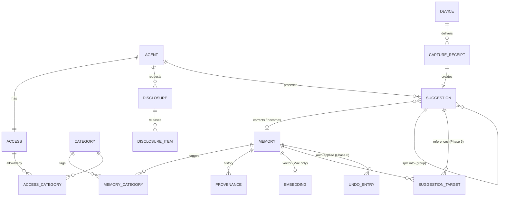
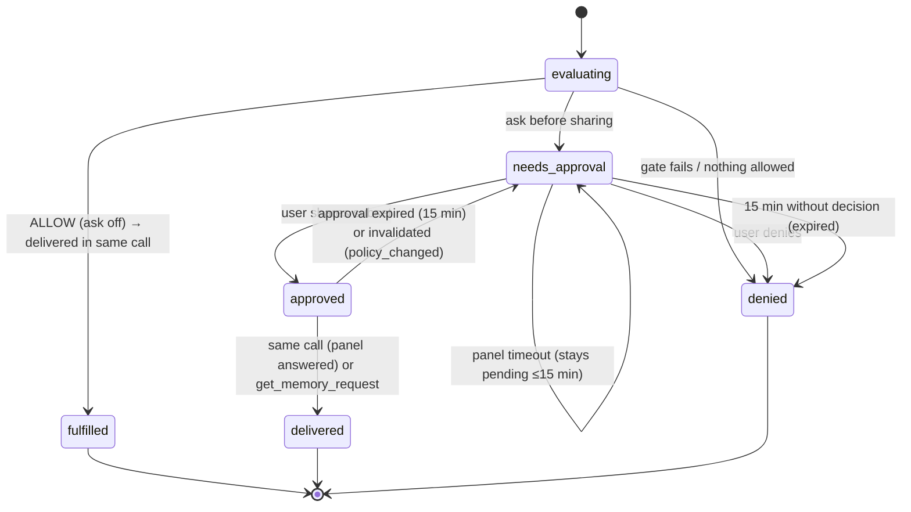
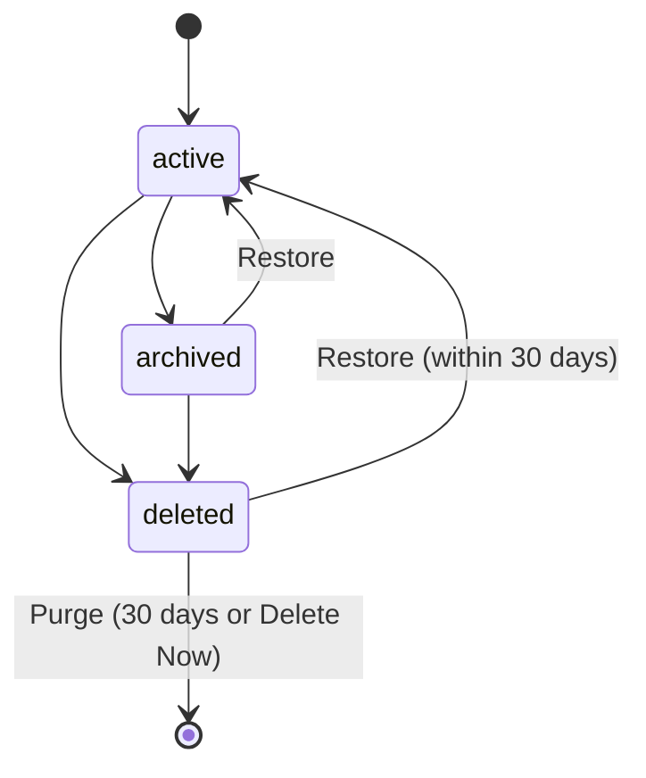

# Domain model

**This is a fresh design.** The Funes Vault web schema is used only as reference; [ADR-0010](../architecture/decisions/0010-start-from-scratch.md) explains why. The physical SQLite schema is in [storage](../architecture/storage.md).

## Entities

### Memory
A durable piece of personal context.

| Field | Type | Notes |
|---|---|---|
| `id` | UUID | Stable, never reused |
| `title` | string, 1–180 | Shown in panels, search and lists |
| `body` | string, 1–10,000 | The text released to agents is `title: body` |
| `kind` | MemoryKind | |
| `sensitivity` | Sensitivity | Default LOW; Health, Finance and Legal default to SENSITIVE |
| `status` | `active` · `archived` · `deleted` | Expiry is computed, not a status |
| `expiresAt` | date? | Treated as expired when `expiresAt <= now` |
| `confidence` | 0–1? | From suggestions; informational |
| `source` | MemorySource | `manual` · `capture_mac` · `capture_iphone` · `agent_suggestion` · `agent_write` · `import_chatgpt` · `import_claude` · `import_markdown` · `import_funes` · `seed_question` · `tidy_up` (Phase 6: a merge or split result) |
| `sourceAgentId` / `sourceDeviceId` | UUID? | Who it came from |
| `createdAt`, `updatedAt` | timestamps | |
| `lastConfirmedAt` | timestamp? | "Still true" |
| `deletedAt` | timestamp? | Set with status `deleted`; purged 30 days later |
| `version` | int | +1 on every change to the title, body, kind, categories, sensitivity, status or expiry. Used to invalidate disclosures |
| `trust` | `trusted` · `untrusted` | Phase 6. Where the text came from: `trusted` if the user typed or dictated it or applied it from a suggestion; `untrusted` if an agent saved it directly, or auto-apply saved it from an import or shared text. Auto-apply never changes or archives a memory on the strength of untrusted text ([memory processing §5.7](memory-processing.md#57-auto-apply-for-new-memories)). A user edit or Apply makes it trusted |
| `reconciledVersion` | int? | Phase 6. The `version` the daily tidy-up last inspected ([memory processing §9.2](memory-processing.md#92-what-it-looks-at)) |

**Invariants:**
- A memory has at least one category.
- Text passes the secret scanner.
- `deleted` memories are invisible everywhere except Recently Deleted.

### Category
| Field | Type | Notes |
|---|---|---|
| `key` | slug, unique, immutable | e.g. `software_development` |
| `name` | string | Can be renamed |
| `description` | string | |
| `builtin` | bool | Built-in categories can't be deleted |
| `defaultSensitivity` | Sensitivity | LOW, or SENSITIVE for `health`, `finance` and `legal` |
| `sortOrder` | int | |

**Built-in categories** (keys from the web version):
- `communication_style`
- `personal_preferences`
- `software_development`
- `project_context`
- `privacy_preferences`
- `health`
- `finance`
- `legal`

### Suggestion
A proposed memory waiting for review. It is separate from Memory, so memories never have a "pending" state.

| Field | Type | Notes |
|---|---|---|
| `id` | UUID | |
| `origin` | `agent` · `capture_mac` · `capture_iphone` · `import` · `seed_question` · `consolidation` (the daily tidy-up, Phase 6) | |
| `agentId` / `deviceId` / `importRunId` | UUID? | |
| `captureId` | UUID? | Idempotency key for iPhone captures (unique) |
| `targetMemoryId` | UUID? | Set when the suggestion is a correction of an existing memory |
| `targetMemoryVersion` | int? | Phase 6. The target's version when the suggestion was made; checked when it's applied (stale → the card says so) |
| `action` | `create` · `update` · `archive` · Phase 6: `duplicate` (already saved) · `split` · `merge` · `conflict` | Each action has its own apply ([memory processing §5.5](memory-processing.md#55-linking), [§9.5](memory-processing.md#95-inbox-and-auto-apply)). Today only `update` + Replace applies as itself; Phase 6.1 implements the rest |
| `groupId` | UUID? | Phase 6. The original suggestion a piece was split from (status `split`) |
| `intent` | `assertion` · `remember` · `correction` · `retraction`? | Phase 6, from extraction |
| `outsideScope` | bool | Phase 6. A piece of an agent's input outside that agent's scope: never auto-applied, left out of Apply all |
| `title`, `body`, `kind`, `categoryKeys`, `sensitivity`, `expiresAt`, `confidence` | proposed values | All editable before apply |
| `evidence` | string?, ≤ 2,000 | Quoted support from the agent; shown as data |
| `purpose` | string?, ≤ 160 | As reported by the agent |
| `callerMetadata` | JSON? | Inert. Never interpreted |
| `classification` | JSON? | Proposed fields plus the engine that produced them (`apple.foundation`, `rules`, or a provider and model id such as `anthropic/<model>`), and whether the capture was kept on the device by the pre-screen |
| `status` | `pending` · `applied` · `rejected` · `expired` · `split` (Phase 6: replaced by its pieces; the row stays for receipts and idempotency) | |
| `createdAt`, `decidedAt`, `expiresAt` | | Expires 30 days after creation; a group expires as one |
| `resultMemoryId` | UUID? | The memory created or updated when it was applied |

**Phase 6 additions** ([ADR-0020](../architecture/decisions/0020-atomic-extraction-for-every-source.md), [ADR-0021](../architecture/decisions/0021-daily-tidy-up.md)):
- **SuggestionTarget:** `suggestionId`, `memoryId`, `memoryVersion`, `role` (`target` · `source` · `survivor`), so a merge, split or conflict can reference several memories.
- **SuggestionGroup:** `id` (the original suggestion's id), `origin`, `agentId?`, `sourceText`, `engine`, `createdAt`. The source text is dropped once every piece is decided, and purged with its memories.
- **ProcessingJob:** `id`, `subject` (suggestion or memory id), `kind` (`split` · `tidy_up`), `state` (`queued` · `running` · `done` · `failed`), `attempts`, `engine`, `createdAt`. Durable, one at a time, idempotent per subject.
- **UndoEntry:** `id`, `createdAt`, `runId?`, `action`, memory ids, the before-state (JSON, including old text), `expiresAt` (30 days). Purged after 30 days and with its memories when they're purged or deleted now. Never exported.
- **TidyUpRun:** `id`, `startedAt`, `finishedAt`, `engine`, counts (memories inspected, clusters, suggestions, applied), `partial`, error code.
- **TidyUpDismissal:** sorted memory ids plus a content hash, `dismissedAt`.

### Agent
An MCP client the user has added. It is EK Bridge's "connection".

| Field | Type | Notes |
|---|---|---|
| `id` | UUID | |
| `name` | string, unique among active agents | |
| `agentKind` | detected type (`claude_code`, `claude_desktop`, `cursor`, `codex`, `vscode`, `zed`, `gemini_cli`, `devin_desktop`, `cline`, `jetbrains`, `other`; the agents EK Bridge's setup knows; cloud agents add kinds such as `claude_ai`, `chatgpt`, `gemini_enterprise`, `anthropic_api`) | Drives the icon and setup snippets |
| `keyDigest` | SHA-256 | The key's plaintext lives only in the key file |
| `keyIssuedAt` | timestamp | |
| `cloudAccess` | bool | Default false. Lets the agent's remote token and OAuth-connected cloud apps reach it through Remote Access ([ADR-0018](../architecture/decisions/0018-remote-access-in-v0.1.md)). It never changes the agent's access |
| `remoteKeyDigest`, `remoteKeyIssuedAt` | SHA-256?, timestamp? | The remote token (`fns_mcpr_v1_`), only with `cloudAccess`. Deleted when cloud access is turned off |
| `paused` | bool | |
| `revision` | int | +1 on any change to access, pause, key, cloud access, remote token or connected cloud apps. Pending approvals bind to it |
| `declaredRetention` | `none` · `session` · `persistent` · `unknown` | Informational |
| `asksForAccess` | bool | Default false |
| `firstRequestAt`, `lastRequestAt` | timestamp? | |
| `createdAt`, `removedAt` | | Removal deletes the key file and grants; the row stays for Activity labels |

### Access (one per agent)
| Field | Type | Default |
|---|---|---|
| `operations` | set of `read`, `suggest`, `write` | empty (no access) |
| `maxSensitivity` | Sensitivity | LOW |
| `allowedCategoryKeys` | set | empty, meaning **all** categories |
| `deniedCategoryKeys` | set | empty |
| `askBeforeSharing` | bool | true |
| `askBeforeSaving` | bool | true (relevant only with `write`) |
| `expiresAt` | timestamp? | none |

**Allow window** (optional, FR-D-12): `{agentId, revision, until, maxSensitivity ≤ LOW}`, held in memory only.

### Disclosure (a request from an agent to read memories)
| Field | Type | Notes |
|---|---|---|
| `id` | UUID | Returned to the agent as `request_id` |
| `agentId`, `agentRevisionAtRequest` | | |
| `taskHash`, `taskLength` | | The task text is **not** stored. It is held in memory for the panel and the pending list (≤ 15 min) |
| `purpose` | string? ≤ 160 | Stored (short, agent-reported, shown "as reported") |
| `retention` | enum | As reported |
| `processors` | [string] ≤ 12 | As reported (third parties that will see the text) |
| `maxTokens` | int 100–8,000 | Default 1,200 |
| `requestedCategoryKeys` | [key] ≤ 24 | Narrows retrieval only. It can never widen access |
| `status` | see the state machine | |
| `reason` | ReasonCode? | |
| `candidateSnapshot` | JSON | `[{memoryId, version}]` of the eligible memories when the request was evaluated |
| `snapshotRevision` | SHA-256 | Covers the candidate ids and versions, the agent revision and the instructions |
| `approvedMemoryIds` | [UUID]? | The chosen subset |
| `approvalExpiresAt` | timestamp? | Approval time + 15 min |
| `withheld` | JSON | `{reasonCode: count}` |
| `createdAt`, `decidedAt`, `deliveredAt` | | |

**DisclosureItem** (written at delivery): `disclosureId`, `memoryId`, `memoryVersion`, `sensitivity`, `categoryKey`, `estimatedTokens`, `clipped`. The text is **not** stored; it is regenerated from the memory version at delivery, and delivery requires that version to still be current.

### Device (a paired iPhone)
| Field | Type | Notes |
|---|---|---|
| `id` | UUID | |
| `name`, `model` | string | |
| `signingPublicKey` | P-256 (X9.63 raw) | Secure Enclave–backed on the phone when available |
| `hpkePublicKey` | P-256 | For encrypting responses to the device (see the protocol) |
| `pairedAt`, `lastSeenAt`, `lastTransport` | | `lan` · `tailscale` · `tunnel` |
| `revokedAt` | timestamp? | |
| `approvalsEnabled` | bool | Default true once paired. Approvals from this iPhone, and whether the Mac rings it ([FR-iOS-12](../product/03-requirements.md)) |
| `doorbellTag` | string? | Random, 128 bits, base64url. Made when the phone first asks for it while approvals are on, so the Mac rings only phones that subscribed; dropped when approvals are turned off ([ADR-0019](../architecture/decisions/0019-cloudkit-doorbell-for-iphone-approvals.md)) |

**CaptureReceipt:** `captureId` (unique), `deviceId`, `receivedAt`, `suggestionId`. It makes delivery idempotent and is kept for 90 days.

### Provenance entry
`memoryId`, `at`, `event` (`created` · `edited` · `archived` · `restored` · `deleted` · `shared` · `suggested_correction` · `applied_from_suggestion` · `confirmed`; Phase 6: `split_into` · `split_from` · `merged_into` · `merged_from` · `auto_applied` · `undone`), `actor` (`user` · `agent:<id>` · `device:<id>` · `import:<id>`; Phase 6: `system`), `fieldsChanged` (names only), `relatedMemoryId` (Phase 6: the other side of a split or merge), `engine` (Phase 6: the model that proposed an auto-applied change). No text.

### Activity record
Stored in an append-only JSONL file (the EK Bridge `ActivityStore` pattern):
- `time`, `requestId`, `phase` (`start` · `result` · `event`);
- `actor` (agent, device, user or system), `via` (`mcp` · `remote` · `companion` · `app`), `event`, `outcome`;
- ids, `reason`, `counts`, `approval` (`approved` · `denied` · `timeout` · `not_required`);
- `agentReportedName` (sanitized, ≤ 64 bytes).

No text, task, keys or bodies.

## Enumerations

| Enum | Values |
|---|---|
| MemoryKind | `fact`, `preference`, `instruction`, `goal`, `project_context`, `relationship`, `constraint`, `event`, `summary` |
| Sensitivity (ordered) | `public` (0) < `low` (1) < `internal` (2) < `sensitive` (3) < `restricted` (4) < `secret` (5) |
| Operation | `read`, `suggest`, `write` |
| Retention | `none`, `session`, `persistent`, `unknown` |
| DisclosureStatus | `evaluating`, `fulfilled`, `needs_approval`, `approved`, `delivered`, `denied`, `failed` |
| SuggestionStatus | `pending`, `applied`, `rejected`, `expired`, `split` (Phase 6) |
| SuggestionAction | `create`, `update`, `archive`; Phase 6: `duplicate`, `split`, `merge`, `conflict` |
| MemoryTrust | `trusted`, `untrusted` (Phase 6) |

Reason codes are listed in [access policy](access-policy.md#8-reason-codes).

## State machines

### Disclosure

- `fulfilled` means delivered without approval; `delivered` means delivered after approval. Both are terminal and record DisclosureItems.
- A request still `needs_approval` 15 minutes after creation becomes `denied` with reason `approval_expired`.

### Suggestion

```mermaid
stateDiagram-v2
    [*] --> pending
    pending --> applied: Apply / Save (per action: creates, updates, archives, merges or splits)
    pending --> applied: auto-apply (Phase 6, the user's setting)
    pending --> split: replaced by its pieces (Phase 6)
    pending --> rejected: Reject / Discard
    pending --> expired: 30 days
    expired --> pending: Restore (within 7 days; another 30 days)
    applied --> [*]
    rejected --> [*]
    split --> [*]
```

- A targeted suggestion whose memory changed since it was made is **stale**: Apply shows the current memory and asks again (Phase 6).

### Memory

