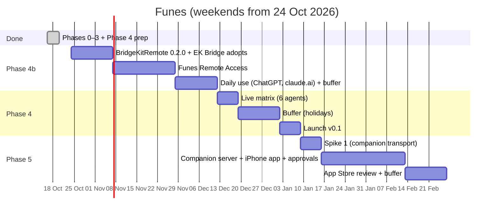
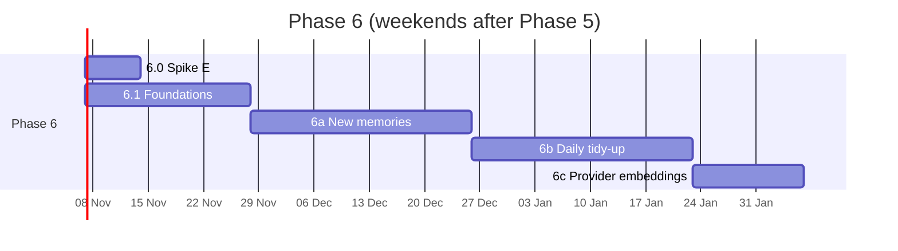

# Roadmap

Planned as a **side project**: about one weekend (around 8–10 h) per week. Dates below assume a start on **Saturday 24 Oct 2026**; shift them as life requires. The order and the exit criteria matter more than the dates.

## Timeline

**Status (2026-10-19):** Phases 0–3 and Phase 4's preparation are done. [Phase 4b](../plans/phase-4b-remote-access.md) (Remote Access, [ADR-0018](../architecture/decisions/0018-remote-access-in-v0.1.md)) comes before the launch. The chart starts from today's state.

**Update (2026-10-30):** **Phase 10** (the menu bar panel, v0.7) is planned: see [v0.7](#v07-menu-bar-panel-phase-10).

**Update (2026-10-27):** v0.3, v0.4 and v0.5 ship together as version **0.5.0** (build 11), on the Mac and as the iPhone's next App Store version; the iPhone's first App Store version stays 0.2.0.

**Update (2026-10-26):** **Phase 8** (About you, v0.5) is planned: see [v0.5](#v05-about-you-phase-8).

**Update (2026-10-25):** **Phase 7** (Home and widgets, v0.4) is planned: see [v0.4](#v04-home-and-widgets-phase-7).

**Update (2026-10-23):** the Mac's v0.2.0 is out and Phase 5 is finishing. **Phase 6** (memory processing, v0.3) is planned next: see [v0.3](#v03-memory-processing-phase-6) below. Its own chart is in that section.

| Milestone | Target (≈) | Exit criteria |
|---|---|---|
| **M0 Spikes answered** | 31 Oct 2026 | Spikes 2 and 3 recorded; search and approval-wait choices made |
| **M1 Core green** | 14 Nov 2026 | Every policy test vector green; search benchmark at or above the baseline |
| **M2a BridgeKit 0.1.0** | 21 Nov 2026 | BridgeKitCore tagged; EK Bridge released on it with unchanged, green tests |
| **M2 Agents connect** | 5 Dec 2026 | Claude Code requests, approves and suggests against the real vault |
| **M3 Daily driver** | 26 Dec 2026 | The author uses Funes daily with 2+ agents for a week |
| **M3b Cloud agents** | 12 Dec 2026 | BridgeKit 0.2.0 tagged and EK Bridge released on it; the author uses ChatGPT and claude.ai with Funes daily for a week |
| **M4 v0.1 Mac public preview** | 2–9 Jan 2027 | Notarized DMG, Homebrew cask, MCP Registry, Sparkle update tested, live matrix recorded (6 agents, ChatGPT and claude.ai included) |
| **M5 Companion proven** | 16 Jan 2027 | Spike 1 matrix green |
| **Name hold** | before ~14 Apr 2027 | Upload any TestFlight build to keep "Funes Vault" reserved in App Store Connect (record created 16 Oct 2026) |
| **M6 v0.2 iPhone companion** | Feb–Mar 2027 (+ review) | A capture made with the Mac asleep arrives exactly once; search and edit work over Wi-Fi and Tailscale; a request is approved from the phone; App Store approved |

That's roughly **10–11 weekends to v0.1** and **16–17 weekends to v0.2**, including one weekend for BridgeKit, plus **4–5 weekends for Phase 4b** before the launch and one more in Phase 5 for approvals from the iPhone.

## Release scopes

### v0.1: Mac public preview
**In:**
- **Vault:** create, edit, archive, delete, categories (built-in plus custom), sensitivity, expiry, provenance, hybrid search (FTS5 with stemming plus bundled bge-small embeddings on the Mac; [ADR-0016](../architecture/decisions/0016-bundled-bge-small-embeddings.md)).
- **Capture:** hotkey, menu bar, Services; classification proposals.
- **Inbox:** agent suggestions, captures, seed questions, imports (ChatGPT, Claude, Markdown).
- **Agents:**
  - keys, starting presets, the access editor;
  - pause, remove, rotate key;
  - one-click setup for 4 agents and snippets for about 12;
  - "let it ask for more access".
- **Disclosure:** the policy engine, the Share panel with partial approval, the 45 s in-call wait, the 15-minute pending list, single use, invalidation, withheld counts.
- **Suggestions:** the Save panel (non-blocking), direct Write when allowed.
- **Activity:** log and view.
- **AI models:** Apple on-device by default; per-task choice of local servers (Ollama, LM Studio) or cloud providers (OpenAI, Anthropic, Gemini, OpenRouter, custom), with a cloud sensitivity limit, disclosures and Keychain keys. For **classification**; embeddings use the bundled model in v0.1.
- **Distribution:** MCP server, launcher, Sparkle, Homebrew, MCP Registry, docs.
- **Remote Access for cloud agents (experimental):** ChatGPT, claude.ai and Gemini Enterprise over OAuth, header-based cloud agents with a remote token, through a tunnel the user runs (guided setup); an Allow cloud access switch per agent; the same policy as local agents ([ADR-0018](../architecture/decisions/0018-remote-access-in-v0.1.md)). Off by default.

**Out:**
- the iPhone app;
- consolidation (v0.3, the daily tidy-up);
- the allow window;
- a CLI;
- localization.

### v0.2: iPhone companion
**In:**
- **Mac:** the companion server (Wi-Fi, Tailscale, optional public tunnel), pairing, devices.
- **iPhone:** capture (in-app, share sheet, App Intent, Control, dictation), the offline queue with exactly-once delivery, search, detail, edit, Inbox review, demo mode, App Store.
- **Approvals from the iPhone:** a notification for each request waiting for approval, answered on the phone. The push carries no memory text; the channel is [Q24](../plans/open-questions.md).

### v0.3: Memory processing (Phase 6)
Brings back, and extends, what the web version did with a model ([ADR-0020](../architecture/decisions/0020-atomic-extraction-for-every-source.md) to [ADR-0023](../architecture/decisions/0023-provider-embeddings-second-index.md)). Mac only, plus a small iPhone change. About 11–14 weekends.

| Step | Plan | Exit criteria |
|---|---|---|
| **6.0 Spike E** | [plan](../plans/phase-6-0-spike-e.md) | Measured answers: Apple on-device's role, one call or two, unsupported additions, whether confidence gates auto-apply, tidy-up precision per level; synthetic fixtures committed |
| **6.1 Foundations** | [plan](../plans/phase-6-1-foundations.md) | Every suggestion action applies as itself everywhere; durable processing queue; multi-item guard and daily cap; undo log; schema v4 migrated |
| **6a New memories** | [plan](../plans/phase-6a-new-memories.md) | Every input split, classified and linked; auto-apply never on untrusted text; a week of daily use |
| **6b Daily tidy-up** | [plan](../plans/phase-6b-daily-tidy-up.md) | A week of daily runs on the author's vault, with no oscillation and no access widened |
| **6c Provider embeddings** | [plan](../plans/phase-6c-provider-embeddings.md) | A benchmark gain over bge-small; sensitive memories keep semantic search |

**In:**
- **New memories:** every input (captures, seed answers, agent suggestions and writes, imports) split into atomic pieces, classified and linked (new, update, already saved, retract).
- **Daily tidy-up:** update, merge, split, archive and conflict proposals, daily or on demand.
- **Auto-apply** (off by default) with Undo for 30 days, never on the strength of untrusted text.
- **Subscription providers:** the user's Claude or ChatGPT plan through their own Claude Code or Codex, isolated and fail-closed ([ADR-0024](../architecture/decisions/0024-subscription-providers.md)).
- **Cloud limit up to everything,** one limit for every task, and a daily cap on cloud requests.
- **Provider embeddings** as a second index, if the benchmark shows a gain.

### v0.4: Home and widgets (Phase 7)
Brings back the web version's Home ([ADR-0025](../architecture/decisions/0025-vault-overview-and-iphone-cache.md)), with what only Funes knows: what went out to your agents. Mac and iPhone, updated together. About 5–6 weekends.

| Step | Plan | Exit criteria |
|---|---|---|
| **7.1 Status bar** | [plan](../plans/phase-7-home.md#71-the-iphones-status-bar--½-weekend) | No header space on the connection while connected; every state has its bar and action; Demo always labelled |
| **7.2 Overview** | [plan](../plans/phase-7-home.md#72-the-overview--115-weekends) | `VaultOverview` under 50 ms on 10,000 memories; `overview.get` and the cache never carry memory text |
| **7.3 Mac Home** | [plan](../plans/phase-7-home.md#73-mac-home--15-weekends) | The window opens on Home; captures from it behave as the capture box's; a week of daily use |
| **7.4 iPhone Home** | [plan](../plans/phase-7-home.md#74-iphone-home--1-weekend) | Home replaces Capture; charts from the cache with "As of" while the Mac is away |
| **7.5 Widgets** | [plan](../plans/phase-7-home.md#75-iphone-widgets--1-weekend) | Pulse, Remember and Rhythm on the author's Home Screen for a week, refreshed daily |

**In:**
- **iPhone status bar:** the connection banner goes; a bar above the tabs appears only when something needs you.
- **Home on the Mac:** a composer (type or dictate), the pulse chart (in by source, out by agent, refused), Memories, Sensitivity, Rhythm and Who reads; the window opens on it.
- **Home on the iPhone:** replaces Capture, with the same charts, kept from a cache of counts while the Mac is away.
- **iPhone widgets:** Pulse, Remember and Rhythm.

### v0.5: About you (Phase 8)
Funes learns your name and a few details, greets you by name, and gives each agent the ones you tick ([ADR-0026](../architecture/decisions/0026-about-you-profile.md)). About 1.5–2 weekends.

| Step | Plan | Exit criteria |
|---|---|---|
| **8.1 Core** | [plan](../plans/phase-8-about-you.md#81-core--½-weekend) | `v6_profile` migrates a version 5 vault; T36–T46 green |
| **8.2 MCP** | [plan](../plans/phase-8-about-you.md#82-mcp--¼-weekend) | Claude Code and a cloud agent answer "What's my name?" from Funes |
| **8.3 Mac** | [plan](../plans/phase-8-about-you.md#83-mac--¾-weekend) | About You, the Access checkboxes, the Share panel line; Home says the author's name |
| **8.4 iPhone** | [plan](../plans/phase-8-about-you.md#84-iphone--¼-weekend) | Home's title has the name, also while the Mac is away |

**In:**
- **About You** in Settings: name, what to call you, pronouns, languages, location, time zone, occupation; all optional.
- **Greeting by name** on the Mac's and the iPhone's Home.
- **Profile fields per agent:** ticked in Access (Name by default), sent with `request_memory` answers, named in the Share panel and Activity.

### v0.6: Search answers (Phase 9)
Search shows the sentence that matches, and when you ask (or on its own, if you choose), the model you chose answers from the top results, quoting the memory behind every claim, on the Mac and the iPhone ([ADR-0028](../architecture/decisions/0028-search-answers.md)). About 2.5–3 weekends.

| Step | Plan | Exit criteria |
|---|---|---|
| **9.1 Snippets** | [plan](../plans/phase-9-search-answers.md#91-snippets--½-weekend) | Matching-sentence snippets on both apps within 150 ms; used for a few days |
| **9.2 Spike G** | [plan](../plans/phase-9-search-answers.md#92-spike-g-answer-quality--½-weekend) | A provider passes: correct claims ≥ 95%, right "no answer" ≥ 90%, answered ≥ 80%, p95 ≤ 15 s |
| **9.3 Core** | [plan](../plans/phase-9-search-answers.md#93-core--¾-weekend) | `SearchAnswerer` with validation, guardrail and cancellation tests green |
| **9.4 Mac** | [plan](../plans/phase-9-search-answers.md#94-mac--½-weekend) | ⌘⏎ answers "What's my title at Chatham?" in the author's vault, with quotes |
| **9.5 iPhone** | [plan](../plans/phase-9-search-answers.md#95-iphone--½¾-weekend) | The same on the iPhone, over Wi-Fi and Tailscale; demo answers offline |
| **9.6 Ship** | [plan](../plans/phase-9-search-answers.md#96-ship--¼-weekend) | Docs, privacy and CHANGELOG; a week of the author's use |

**In:**
- **Matching snippets** in the Vault and the iPhone's Search.
- **Search answers**, off by default: Ask (⌘⏎ or the Ask row and pill), an answer card in place with a quote per claim, and, if chosen, automatic answers for questions or every search.
- **`memories.answer`** on the companion channel, with its own deadline.

### v0.7: Menu bar panel (Phase 10)
A click on the menu bar icon opens a panel instead of a menu: what waits for you, with Review; the Agents and Remote Access switches; a field that remembers or searches; and the last 24 hours as a chart ([ADR-0029](../architecture/decisions/0029-menu-bar-panel.md)). About 2 weekends.

| Step | Plan | Exit criteria |
|---|---|---|
| **10.0 Spike** | [plan](../plans/phase-10-menu-bar-panel.md#100-spike-closing-a-non-activating-panel--¼-weekend) | The panel closes on every rule (⌘⇥, Spaces, outside clicks) without activating Funes; its field takes text and dictation |
| **10.1 Last 24 hours read** | [plan](../plans/phase-10-menu-bar-panel.md#101-last-24-hours-read--¼-weekend) | `recentPulse` under 20 ms on the benchmark vault, no text (tested) |
| **10.2 Panel shell** | [plan](../plans/phase-10-menu-bar-panel.md#102-the-panel-shell--½-weekend) | Opens and closes as specified without deactivating the frontmost app; right-click menu |
| **10.3 Waiting and switches** | [plan](../plans/phase-10-menu-bar-panel.md#103-waiting-for-you-and-the-switches--½-weekend) | Review opens the right panel; every tile state; pause lengths; Remote Access on asks, off acts |
| **10.4 Field** | [plan](../plans/phase-10-menu-bar-panel.md#104-the-field--½-weekend) | ⏎ saves as the capture box does; ⌘⏎ results and answers as in the Vault |
| **10.5 Chart** | [plan](../plans/phase-10-menu-bar-panel.md#105-the-chart--¼½-weekend) | Hover and click per hour; VoiceOver reads it |
| **10.6 Ship** | [plan](../plans/phase-10-menu-bar-panel.md#106-ship--¼-weekend) | Snapshots, docs and CHANGELOG; a few days of the author's use |

**In:**
- **The menu bar panel** and its right-click menu, replacing the menu.
- **A "can't connect" icon state.**
- **`recentPulse`,** the last 24 hours by hour, on the Mac only.

### v0.8: Settings (Phase 11)
A Settings window a first-time user can find their way around: a sidebar, AI split into what it does, where models come from and what may leave the Mac, and a different model per task on one account ([ADR-0030](../architecture/decisions/0030-settings-window.md)). About 3 weekends. (v0.7, the menu bar panel of Phase 10, landed first.)

| Step | Plan | Exit criteria |
|---|---|---|
| **11.0 Prototype** | [plan](../plans/phase-11-settings.md#110-navigation-prototype--⅛-weekend) | The sidebar holds its width and can't collapse on every supported macOS, or the fallback is chosen |
| **11.1 Accounts and models** | [plan](../plans/phase-11-settings.md#111-accounts-and-models--¾-weekend) | The author's settings convert; three models on one account, one per task; tests green |
| **11.2 The window** | [plan](../plans/phase-11-settings.md#112-the-window--½-weekend) | Eleven panes, destinations and deep links; every moved control works as before |
| **11.3 Features** | [plan](../plans/phase-11-settings.md#113-ai--features--½-weekend) | Four job rows and pages, with their disclosure lines |
| **11.4 Models & Accounts** | [plan](../plans/phase-11-settings.md#114-ai--models--accounts--½-weekend) | Account and plan pages, Add Account…, removal that asks |
| **11.5 Privacy & Limits** | [plan](../plans/phase-11-settings.md#115-ai--privacy--limits--¼-weekend) | The cloud limit, the cap and What AI features send |
| **11.6 Ship** | [plan](../plans/phase-11-settings.md#116-words-snapshots-ship--¼-weekend) | Every Settings path updated, snapshots looked at, a few days of the author's use |

**In:**
- **A sidebar Settings window** with eleven panes in four groups, and pages inside panes.
- **AI ▸ Features, Models & Accounts, Privacy & Limits** instead of one AI Models tab.
- **Several models per account and per plan**, chosen per task.

### v0.9: Every Inbox card on the iPhone (Phase 12)
The iPhone answers every card the Mac's Inbox does, the daily tidy-up's included, showing the memories each one changes first ([ADR-0031](../architecture/decisions/0031-iphone-answers-every-inbox-card.md)). About 1 weekend.

| Step | Plan | Exit criteria |
|---|---|---|
| **12.1 Spec** | [plan](../plans/phase-12-iphone-inbox.md#121-spec--⅛-weekend) | ADR-0031 and protocol §4.2, reviewed |
| **12.2 Protocol and the Mac** | [plan](../plans/phase-12-iphone-inbox.md#122-protocol-and-the-mac--¼-weekend) | `inbox.get`, modes and Review Again, tested against FunesCore |
| **12.3 FunesPhone** | [plan](../plans/phase-12-iphone-inbox.md#123-funesphone--¼-weekend) | `InboxModel` and the demo answer every card; tests green |
| **12.4 Screens** | [plan](../plans/phase-12-iphone-inbox.md#124-the-iphones-screens--⅓-weekend) | Each card's screen matches the Mac's choices and words |
| **12.5 Ship** | [plan](../plans/phase-12-iphone-inbox.md#125-ship--⅛-weekend) | test.sh green, each card checked in the demo, CHANGELOG |

**In:**
- **`inbox.get`, `inbox.reviewAgain` and `inbox.apply`'s `mode`** on the companion channel.
- **A screen per card type** on the iPhone, and swipe to apply for all but conflicts.

### v0.6+: Later (unordered; pick by real usage)
- **Allow window** for low-sensitivity sharing (if panels cause fatigue).
- **BridgeKitUI extraction** (approvals, activity, agent setup UI, app shell, and the Remote Access views) after v0.1. BridgeKitRemote is extracted in Phase 4b.
- **`funes` CLI** for scripts.
- **Localization,** Spanish first.
- **Pricing decision** at 1.0.
- **At production readiness (1.0):** add a "no longer maintained" note to `funes-vault`'s README, linking to the new repo ([ADR-0010](../architecture/decisions/0010-start-from-scratch.md)).
- **An agent `update_memory` tool** behind Write plus ask-before-saving.
- **Multilingual embeddings built in,** with the Spanish localization. The [Phase 6c benchmark](../plans/spike-results.md#phase-6c1-provider-embeddings-as-a-second-index) ruled out multilingual-e5-small (no gain with Spanish memories, a loss on raw English tasks). Qwen3-Embedding-0.6B (Apache-2.0) is the measured candidate: an optional provider model since 6c (Ollama, LM Studio), with recall@5 from 0.31 to 0.62 for Spanish tasks on English memories. Bundling it instead of bge-small would need its own decision: about 600 MB even at 8 bits (bge-small: 32 MB), and 46–95 ms per query against bge's 4 ms.
- **Local open-source LLM** (Core AI / MLX) as an upgrade path.

## Tracking progress
- **Phase plans** (`plans/phase-*.md`) hold the task checklists; tick them as you go.
- **The [backlog](backlog.md)** maps every requirement to a phase.
- **Spike results** go in `plans/spike-results.md`, and design changes become new ADRs.
