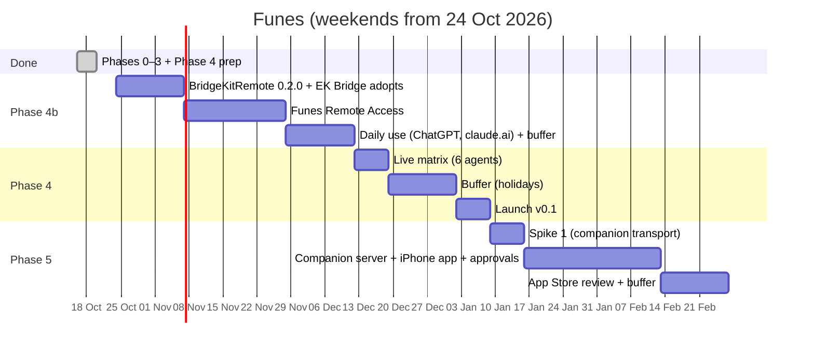
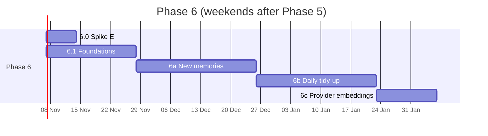

# Roadmap

Planned as a **side project**: about one weekend (around 8–10 h) per week. Dates below assume a start on **Saturday 24 Oct 2026**; shift them as life requires. The order and the exit criteria matter more than the dates.

## Timeline

**Status (2026-10-19):** Phases 0–3 and Phase 4's preparation are done. [Phase 4b](../plans/phase-4b-remote-access.md) (Remote Access, [ADR-0018](../architecture/decisions/0018-remote-access-in-v0.1.md)) comes before the launch. The chart starts from today's state.

**Update (2026-10-25):** **Phase 7** (Home and widgets, v0.4) is planned: see [v0.4](#v04-home-and-widgets-phase-7).

**Update (2026-10-23):** the Mac's v0.2.0 is out and Phase 5 is finishing. **Phase 6** (memory processing, v0.3) is planned next: see [v0.3](#v03-memory-processing-phase-6) below. Its own chart is in that section.

| Milestone | Target (≈) | Exit criteria |
|---|---|---|
| **M0 Spikes answered** | 31 Oct 2026 | Spikes 2 and 3 recorded; search and approval-wait choices made |
| **M1 Core green** | 14 Nov 2026 | Every policy test vector green; search benchmark at or above the baseline |
| **M2a BridgeKit 0.1.0** | 21 Nov 2026 | BridgeKitCore tagged; EK Bridge released on it with unchanged, green tests |
| **M2 Agents connect** | 5 Dec 2026 | Claude Code requests, approves and suggests against the real vault |
| **M3 Daily driver** | 26 Dec 2026 | The author uses Funes daily with 2+ agents for a week |
| **M3b Cloud agents** | 12 Dec 2026 | BridgeKit 0.2.0 tagged and EK Bridge released on it; the author uses ChatGPT and claude.ai with Funes daily for a week |
| **M4 v0.1 Mac public preview** | 2–9 Jan 2027 | Notarized DMG, Homebrew cask, MCP Registry, Sparkle update tested, live matrix recorded (6 agents, ChatGPT and claude.ai included) |
| **M5 Companion proven** | 16 Jan 2027 | Spike 1 matrix green |
| **Name hold** | before ~14 Apr 2027 | Upload any TestFlight build to keep "Funes Vault" reserved in App Store Connect (record created 16 Oct 2026) |
| **M6 v0.2 iPhone companion** | Feb–Mar 2027 (+ review) | A capture made with the Mac asleep arrives exactly once; search and edit work over Wi-Fi and Tailscale; a request is approved from the phone; App Store approved |

That's roughly **10–11 weekends to v0.1** and **16–17 weekends to v0.2**, including one weekend for BridgeKit, plus **4–5 weekends for Phase 4b** before the launch and one more in Phase 5 for approvals from the iPhone.

## Release scopes

### v0.1: Mac public preview
**In:**
- **Vault:** create, edit, archive, delete, categories (built-in plus custom), sensitivity, expiry, provenance, hybrid search (FTS5 with stemming plus bundled bge-small embeddings on the Mac; [ADR-0016](../architecture/decisions/0016-bundled-bge-small-embeddings.md)).
- **Capture:** hotkey, menu bar, Services; classification proposals.
- **Inbox:** agent suggestions, captures, seed questions, imports (ChatGPT, Claude, Markdown).
- **Agents:**
  - keys, starting presets, the access editor;
  - pause, remove, rotate key;
  - one-click setup for 4 agents and snippets for about 12;
  - "let it ask for more access".
- **Disclosure:** the policy engine, the Share panel with partial approval, the 45 s in-call wait, the 15-minute pending list, single use, invalidation, withheld counts.
- **Suggestions:** the Save panel (non-blocking), direct Write when allowed.
- **Activity:** log and view.
- **AI models:** Apple on-device by default; per-task choice of local servers (Ollama, LM Studio) or cloud providers (OpenAI, Anthropic, Gemini, OpenRouter, custom), with a cloud sensitivity limit, disclosures and Keychain keys. For **classification**; embeddings use the bundled model in v0.1.
- **Distribution:** MCP server, launcher, Sparkle, Homebrew, MCP Registry, docs.
- **Remote Access for cloud agents (experimental):** ChatGPT, claude.ai and Gemini Enterprise over OAuth, header-based cloud agents with a remote token, through a tunnel the user runs (guided setup); an Allow cloud access switch per agent; the same policy as local agents ([ADR-0018](../architecture/decisions/0018-remote-access-in-v0.1.md)). Off by default.

**Out:**
- the iPhone app;
- consolidation (v0.3, the daily tidy-up);
- the allow window;
- a CLI;
- localization.

### v0.2: iPhone companion
**In:**
- **Mac:** the companion server (Wi-Fi, Tailscale, optional public tunnel), pairing, devices.
- **iPhone:** capture (in-app, share sheet, App Intent, Control, dictation), the offline queue with exactly-once delivery, search, detail, edit, Inbox review, demo mode, App Store.
- **Approvals from the iPhone:** a notification for each request waiting for approval, answered on the phone. The push carries no memory text; the channel is [Q24](../plans/open-questions.md).

### v0.3: Memory processing (Phase 6)
Brings back, and extends, what the web version did with a model ([ADR-0020](../architecture/decisions/0020-atomic-extraction-for-every-source.md) to [ADR-0023](../architecture/decisions/0023-provider-embeddings-second-index.md)). Mac only, plus a small iPhone change. About 11–14 weekends.

| Step | Plan | Exit criteria |
|---|---|---|
| **6.0 Spike E** | [plan](../plans/phase-6-0-spike-e.md) | Measured answers: Apple on-device's role, one call or two, unsupported additions, whether confidence gates auto-apply, tidy-up precision per level; synthetic fixtures committed |
| **6.1 Foundations** | [plan](../plans/phase-6-1-foundations.md) | Every suggestion action applies as itself everywhere; durable processing queue; multi-item guard and daily cap; undo log; schema v4 migrated |
| **6a New memories** | [plan](../plans/phase-6a-new-memories.md) | Every input split, classified and linked; auto-apply never on untrusted text; a week of daily use |
| **6b Daily tidy-up** | [plan](../plans/phase-6b-daily-tidy-up.md) | A week of daily runs on the author's vault, with no oscillation and no access widened |
| **6c Provider embeddings** | [plan](../plans/phase-6c-provider-embeddings.md) | A benchmark gain over bge-small; sensitive memories keep semantic search |

**In:**
- **New memories:** every input (captures, seed answers, agent suggestions and writes, imports) split into atomic pieces, classified and linked (new, update, already saved, retract).
- **Daily tidy-up:** update, merge, split, archive and conflict proposals, daily or on demand.
- **Auto-apply** (off by default) with Undo for 30 days, never on the strength of untrusted text.
- **Subscription providers:** the user's Claude or ChatGPT plan through their own Claude Code or Codex, isolated and fail-closed ([ADR-0024](../architecture/decisions/0024-subscription-providers.md)).
- **Cloud limit up to everything,** one limit for every task, and a daily cap on cloud requests.
- **Provider embeddings** as a second index, if the benchmark shows a gain.

### v0.4: Home and widgets (Phase 7)
Brings back the web version's Home ([ADR-0025](../architecture/decisions/0025-vault-overview-and-iphone-cache.md)), with what only Funes knows: what went out to your agents. Mac and iPhone, updated together. About 5–6 weekends.

| Step | Plan | Exit criteria |
|---|---|---|
| **7.1 Status bar** | [plan](../plans/phase-7-home.md#71-the-iphones-status-bar--½-weekend) | No header space on the connection while connected; every state has its bar and action; Demo always labelled |
| **7.2 Overview** | [plan](../plans/phase-7-home.md#72-the-overview--115-weekends) | `VaultOverview` under 50 ms on 10,000 memories; `overview.get` and the cache never carry memory text |
| **7.3 Mac Home** | [plan](../plans/phase-7-home.md#73-mac-home--15-weekends) | The window opens on Home; captures from it behave as the capture box's; a week of daily use |
| **7.4 iPhone Home** | [plan](../plans/phase-7-home.md#74-iphone-home--1-weekend) | Home replaces Capture; charts from the cache with "As of" while the Mac is away |
| **7.5 Widgets** | [plan](../plans/phase-7-home.md#75-iphone-widgets--1-weekend) | Pulse, Remember and Rhythm on the author's Home Screen for a week, refreshed daily |

**In:**
- **iPhone status bar:** the connection banner goes; a bar above the tabs appears only when something needs you.
- **Home on the Mac:** a composer (type or dictate), the pulse chart (in by source, out by agent, refused), Memories, Sensitivity, Rhythm and Who reads; the window opens on it.
- **Home on the iPhone:** replaces Capture, with the same charts, kept from a cache of counts while the Mac is away.
- **iPhone widgets:** Pulse, Remember and Rhythm.

### v0.5+: Later (unordered; pick by real usage)
- **Allow window** for low-sensitivity sharing (if panels cause fatigue).
- **BridgeKitUI extraction** (approvals, activity, agent setup UI, app shell, and the Remote Access views) after v0.1. BridgeKitRemote is extracted in Phase 4b.
- **`funes` CLI** for scripts.
- **Localization,** Spanish first.
- **Pricing decision** at 1.0.
- **At production readiness (1.0):** add a "no longer maintained" note to `funes-vault`'s README, linking to the new repo ([ADR-0010](../architecture/decisions/0010-start-from-scratch.md)).
- **An agent `update_memory` tool** behind Write plus ask-before-saving.
- **Multilingual embeddings built in,** with the Spanish localization. The [Phase 6c benchmark](../plans/spike-results.md#phase-6c1-provider-embeddings-as-a-second-index) ruled out multilingual-e5-small (no gain with Spanish memories, a loss on raw English tasks). Qwen3-Embedding-0.6B (Apache-2.0) is the measured candidate: an optional provider model since 6c (Ollama, LM Studio), with recall@5 from 0.31 to 0.62 for Spanish tasks on English memories. Bundling it instead of bge-small would need its own decision: about 600 MB even at 8 bits (bge-small: 32 MB), and 46–95 ms per query against bge's 4 ms.
- **Local open-source LLM** (Core AI / MLX) as an upgrade path.

## Tracking progress
- **Phase plans** (`plans/phase-*.md`) hold the task checklists; tick them as you go.
- **The [backlog](backlog.md)** maps every requirement to a phase.
- **Spike results** go in `plans/spike-results.md`, and design changes become new ADRs.
