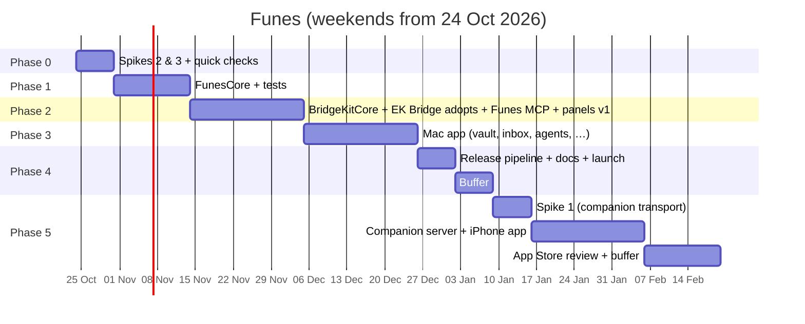

# Roadmap

Planned as a **side project**: about one weekend (around 8–10 h) per week. Dates below assume a start on **Saturday 24 Oct 2026**; shift them as life requires. The order and the exit criteria matter more than the dates.

## Timeline

| Milestone | Target (≈) | Exit criteria |
|---|---|---|
| **M0 Spikes answered** | 31 Oct 2026 | Spikes 2 and 3 recorded; search and approval-wait choices made |
| **M1 Core green** | 14 Nov 2026 | Every policy test vector green; search benchmark at or above the baseline |
| **M2a BridgeKit 0.1.0** | 21 Nov 2026 | BridgeKitCore tagged; EK Bridge released on it with unchanged, green tests |
| **M2 Agents connect** | 5 Dec 2026 | Claude Code requests, approves and suggests against the real vault |
| **M3 Daily driver** | 26 Dec 2026 | The author uses Funes daily with 2+ agents for a week |
| **M4 v0.1 Mac public preview** | 2–9 Jan 2027 | Notarized DMG, Homebrew cask, MCP Registry, Sparkle update tested, live matrix recorded |
| **M5 Companion proven** | 16 Jan 2027 | Spike 1 matrix green |
| **Name hold** | before ~14 Apr 2027 | Upload any TestFlight build to keep "Funes Vault" reserved in App Store Connect (record created 16 Oct 2026) |
| **M6 v0.2 iPhone companion** | Feb 2027 (+ review, possibly early Mar) | A capture made with the Mac asleep arrives exactly once; search and edit work over Wi-Fi and Tailscale; App Store approved |

That's roughly **10–11 weekends to v0.1** and **16–17 weekends to v0.2**, including one weekend for BridgeKit.

## Release scopes

### v0.1: Mac public preview
**In:**
- **Vault:** create, edit, archive, delete, categories (built-in plus custom), sensitivity, expiry, provenance, keyword search (FTS5 with stemming; [ADR-0015](../architecture/decisions/0015-keyword-search-first.md)).
- **Capture:** hotkey, menu bar, Services; classification proposals.
- **Inbox:** agent suggestions, captures, seed questions, imports (ChatGPT, Claude, Markdown).
- **Agents:**
  - keys, starting presets, the access editor;
  - pause, remove, rotate key;
  - one-click setup for 4 agents and snippets for about 12;
  - "let it ask for more access".
- **Disclosure:** the policy engine, the Share panel with partial approval, the 45 s in-call wait, the 15-minute pending list, single use, invalidation, withheld counts.
- **Suggestions:** the Save panel (non-blocking), direct Write when allowed.
- **Activity:** log and view.
- **AI models:** Apple on-device by default; per-task choice of local servers (Ollama, LM Studio) or cloud providers (OpenAI, Anthropic, Gemini, OpenRouter, custom), with a cloud sensitivity limit, disclosures and Keychain keys. For **classification** only; embeddings come later.
- **Distribution:** MCP server, launcher, Sparkle, Homebrew, MCP Registry, docs.

**Out:**
- the iPhone app;
- Remote Access for cloud agents;
- consolidation;
- the allow window;
- a CLI;
- localization.

### v0.2: iPhone companion
**In:**
- **Mac:** the companion server (Wi-Fi, Tailscale, optional public tunnel), pairing, devices.
- **iPhone:** capture (in-app, share sheet, App Intent, Control, dictation), the offline queue with exactly-once delivery, search, detail, edit, Inbox review, demo mode, App Store.

### v0.3+: Later (unordered; pick by real usage)
- **Consolidation:** duplicate, conflict and stale detection, review-only ([processing §9](../domain/memory-processing.md#9-consolidation-v03-later)).
- **Remote Access for claude.ai and ChatGPT** (EK Bridge's OAuth and tunnel).
- **Allow window** for low-sensitivity sharing (if panels cause fatigue).
- **Approvals from the iPhone** (needs a push channel; see [Q16](../plans/open-questions.md)).
- **BridgeKitUI extraction** (approvals, activity, agent setup UI, app shell) after v0.1, then **BridgeKitRemote** when Remote Access arrives.
- **`funes` CLI** for scripts.
- **Localization,** Spanish first.
- **Pricing decision** at 1.0.
- **At production readiness (1.0):** add a "no longer maintained" note to `funes-vault`'s README, linking to the new repo ([ADR-0010](../architecture/decisions/0010-start-from-scratch.md)).
- **An agent `update_memory` tool** behind Write plus ask-before-saving.
- **Semantic search as an opt-in** ([ADR-0015](../architecture/decisions/0015-keyword-search-first.md)): an Embeddings row in Settings ▸ AI Models (off by default) with local servers, cloud models, or a bundled open model (Spike 2b: bge-small or e5-small as Core ML), plus re-embedding and calibration. Must beat the keyword baseline.
- **Foundation Models query expansion for agent retrieval** (+0.10 recall@5 in Spike 2, about 3.7 s per request; cache per task).
- **Local open-source LLM** (Core AI / MLX) as an upgrade path.

## Tracking progress
- **Phase plans** (`plans/phase-*.md`) hold the task checklists; tick them as you go.
- **The [backlog](backlog.md)** maps every requirement to a phase.
- **Spike results** go in `plans/spike-results.md`, and design changes become new ADRs.
